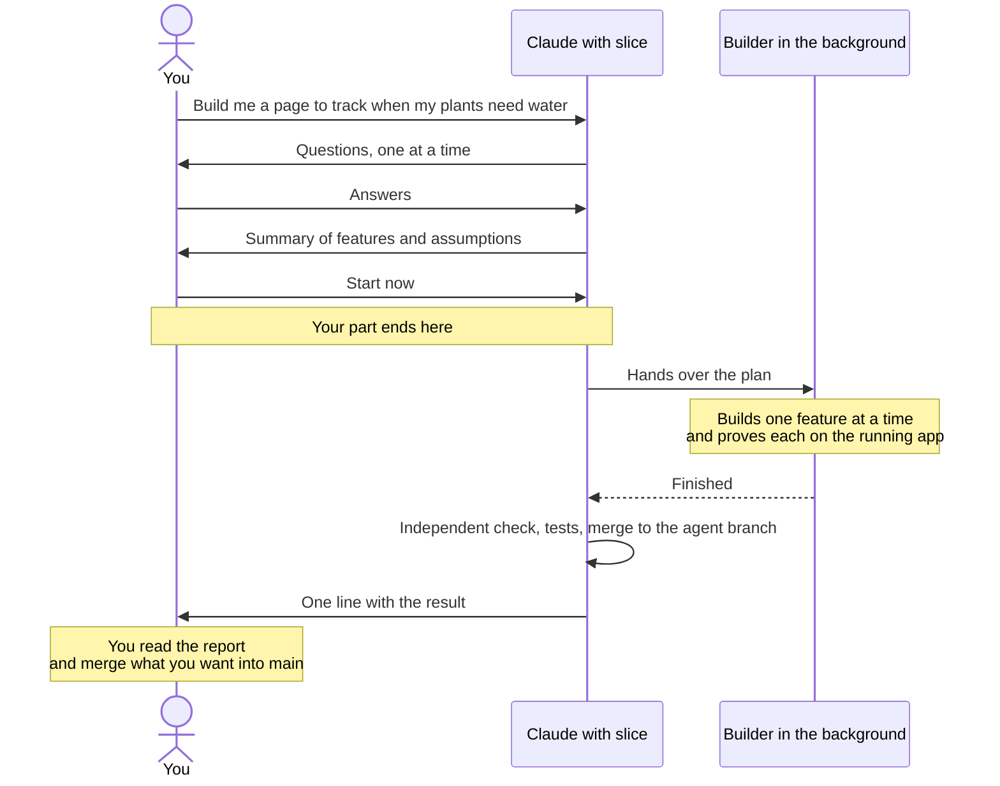

# slice guide

This guide covers everything you do with slice. Read it once before your first run; later the sentences, the tips and the table of problems are enough. The [README](README.md) is the reference for how it works inside.

## What slice does for you

You describe what you want in the Claude Code chat. slice asks the questions a good product owner would ask, writes a plan and then builds it in the background, one feature after another, each one proven by running it.



After you pick `Start now` the chat is free, and slice comes back with one line.

Three rules hold for every run:

- Your checkout and your main branch stay untouched. Finished work goes to a separate agent branch, and only you merge it into main.
- A feature counts as done only after the steps you agreed on ran against the real app.
- slice never stops to ask. A missing key or a question only you can answer becomes a temporary solution and a numbered decision for later.

## What you get and what happens on disk

Five terms come up all the time (all of them are in the [glossary](#glossary)):

- A plan is one piece of work: a spec and a list of features with test steps. Its plan ID looks like `20261104-plants` (date and a short name).
- The agent branch (`agent` by default) is where slice merges finished work.
- Each run builds on its own run branch (`slice/run-<id>`) in a worktree, a second folder of your repo under `~/.cache/slice/<repo>/`.
- The builder is a separate Claude Code session that writes the code.
- A decision is a question only you can answer, numbered `D1`, `D2` and so on.

Setup creates two files in your repo, `.claude/slice.json` (the marker that turns slice on) and `.claude/slice-run.json` (the run settings). It does not commit them; `.claude/slice-run.json` may be gitignored. It also creates the branch `agent`. Plans, decisions and all code from runs are committed only on `agent`. Your checkout is never switched, and nothing is committed on your main branch, with one exception: a folder with no commits at all gets a first commit on main that contains only a README, because a branch needs a commit to start from. Setup tells you when it makes it.

A first small run is cheap. In tests a small plan cost between about 0.65 $ and 3 $; the routine's end-to-end run took about 6 minutes. Bigger plans cost more: an 11-feature web app cost about 6 $ on Sonnet and about 10 $ on Opus. There is no dollar cap.

If you close Claude Code during a local run, whether the builder keeps running is not verified. Either way nothing is lost: each finished feature is already committed on the run branch, and "check my plans" or "start plan `<id>`" resumes a stopped run.

## Before you start

- [ ] Claude Code, git and Node.js are installed (`claude --version`, `git --version`, `node --version`).
- [ ] The cflow marketplace is added and slice is installed: `/plugin marketplace add ahlerjam/cflow`, then `/plugin install slice@cflow`. `claude plugin list` shows `slice`.
- [ ] You have a git repo with a clean `git status`, or an empty folder. In an empty folder setup offers to run `git init` and create the basics.
- [ ] For an existing app you know how it starts and how it is tested.
- [ ] Optional, for cloud runs: a GitHub remote, your current branch pushed, `expect` installed.
- [ ] Optional, for the check-in routine: slice enabled in your claude.ai account.

## Your first run

Your part takes about ten minutes. The build runs on its own afterwards.

1. Open a terminal in the repo or empty folder and start `claude`.
2. Type "set up slice" as a normal chat message. No slash command is needed.
3. Answer setup's questions and allow writing to `.claude/` when Claude asks.
4. Describe what you want, in plain words.
5. Answer the interview and confirm the summary.
6. The start question appears as a selection. Pick `Start now`.

Here is how that looks in an empty folder. The interview is shortened; `>` marks the recommended option of a selection.

```text
You     set up slice

Claude  I wrote .claude/slice.json with the defaults I found.
        Test command?
        > make test (recommended)
          another command
You     make test
Claude  This folder has no commits yet. I can set up git, make targets for
        start, test and lint, and a short CLAUDE.md. They go on the agent
        branch; main only gets a README, so the branch has a commit to start
        from. Shall I?
You     yes
Claude  slice is set up. Just describe what to build; "show my plans" lists
        the plans.

You     Build me a page where I track when my plants need water.

Claude  This is a new app, so I plan in deep mode.
        Who uses it, and on which device?
You     Only me, mostly on my phone.
Claude  How should a plant that needs water stand out?
        > Overdue plants on top, with "3 days overdue" (recommended)
          A colored dot, list sorted by name
You     Overdue plants on top.
Claude  Where should the data live?
        > In the browser, no account (recommended)
          On a small server with a database
You     You decide.
        ...
Claude  Planned features:
        f1  Add a plant with a name and an interval in days; it shows in the list
        f2  Overdue plants on top with "3 days overdue", the rest by next date
        f3  Mark a plant as watered today; its next date moves on
        f4  Edit or delete a plant; a delete can be undone for 10 seconds
        Assumption: data stays in the browser's local storage
        Assumption: the empty list says "No plants yet. Add your first one."
        Assumption: a day starts at midnight in the phone's time zone
        Confirm or correct?
You     Undo for 5 seconds is enough, the rest is fine.
Claude  Changed f4 to 5 seconds. Saved as plan 20261104-plants.
        > Start now (recommended)
          Park
          Plan another task
You     Start now
Claude  The run started.

Claude  Done: 4/4 features merged to agent, report: 0b29cdf
```

Setup asks at most two questions about its settings (the test command when it cannot find one, and network hosts beyond the package registries when the app needs them), then shows what it proposes to add and waits for your OK. The interview names its mode and turns "you decide" into an assumption you can see in the summary. `20261104-plants` is the plan ID you use in later sentences. `Park` saves the plan without starting it; you start it later with "start plan 20261104-plants", or a check-in picks it up. With a GitHub remote, the start question also offers `Start in the cloud`.

In the last line, `0b29cdf` is the commit on the agent branch that holds the report. Read it with `git log -1 --format=%B 0b29cdf`. With the Claude Docs connector, the line links to the changelog doc instead.

How to check that each step worked:

| Step | What you see | What proves it |
| :- | :- | :- |
| Setup | "slice is set up" | `.claude/slice.json` exists; `git branch` lists `agent` |
| Plan | "Saved as plan `<id>`" | `git log --oneline -1 agent` shows `slice: plan <id>` |
| Start | "The run started." | "How far is the run?" answers with features done of total |
| Done | `Done: 4/4 features merged to agent, …` | `git log --oneline main..agent` lists `slice: f1 …` to `slice: done <id>` |

## The sentences you need

A plain question about the code ("what does this function do?") is answered normally. A request to build, change or fix something starts planning; a change in one place gets quick mode with at most six questions. German works too ("zeig meine Pläne", "prüfe meine Pläne").

| Write | What happens |
| :- | :- |
| "Set up slice" | Setup for this repo, once. |
| "Build …", "Add …", "Fix …" | Interview, plan, start question. |
| "Show my plans" | Every plan with its state, progress and what it waits for. |
| "Start plan `<id>`" | Runs a parked plan here, or resumes a halted or partial one. |
| "Start plan `<id>` in the cloud" | Runs it in a Claude Code cloud session. |
| "How far is the run?" | Features done of total and the last commit; for a cloud plan read from GitHub, with the session link. |
| "Stop the run" | Stops the builder and keeps its work. |
| "Plan decision D2: …" | Turns decision D2 into a new plan with your instructions. |
| "Change plan `<id>`: …", "Delete plan `<id>`" | Edits or removes a plan that is not running. |
| "Start all pending plans in the cloud" | One cloud session per pending plan that waits for nothing. |
| "Check my plans" | Resumes, starts the next plans one after another, reports what needs you. |
| "Set up a check-in routine" | An hourly routine in the cloud that runs "check my plans" for you. |

`/slice:setup`, `/slice:shape` and `/slice:run` do the same, for the rare case that a sentence lands somewhere else.

## Planning well

The interview decides most of the result. In a measurement, planning with the interview raised the hidden requirements a build met from 3 of 16 to 10 of 16.

- Be concrete. Exact button labels, messages, number formats and edge cases go into the test steps word for word. "Show the total as 1.234,50 €" is checked; "show the total nicely" is not.
- Say "you decide" freely. It settles that one question with slice's recommendation, and the choice appears as an assumption in the summary.
- Read the summary line by line. Every assumption has its own line, and this is the cheapest moment to correct one.
- Name keys and services up front: payment provider, mail service, API accounts. slice records the variable names, never the values. A key missing at run time is no blocker; the builder uses a fake and leaves you a decision.
- Answer the testability question. The builder can prove date logic and imports only if it knows how a test sets the current date or the data folder.
- Say what is out of scope. slice plans the complete product you describe and adds its own suggestions only when you agree.
- Let slice pick the depth, or say "use deep mode" or "quick mode is enough". The depth also picks the builder model: Sonnet for small changes, Opus for anything bigger, Opus with an Opus advisor for large plans.
- Check big plans before you start them: "show my plans", then the files in `.slice/plans/<id>/` on the agent branch (see [step 2 below](#taking-the-work-to-main)). "Change plan `<id>`: …" fixes one before it runs.

In existing code slice explores the affected area first, so you do not need to explain the codebase. If your idea has a weaker approach, slice says so and why.

## While it runs and after

### Following a run

The builder works in the background. You can keep chatting and keep working in your checkout.

- "How far is the run?" gives features done of total and the last commit.
- Push notifications arrive after each finished feature and on a halt, when the session can send them.
- At the end the chat gets exactly one line. Everything else is in the report.

### Reading the report

The report goes into the commit `slice: done <id>` on the agent branch and, with the Claude Docs connector, into a changelog doc per repo, newest run on top. It has three parts:

1. What works now: one line per feature in your words, with evidence, such as a command and its output or a screenshot name.
2. Decisions for you: new entries `D<n>`, and features left open with the reason.
3. Technical details: run branch, features passed, acceptance result, spend, resumes, refused commands and recipe changes. slice offers to allow refused commands and to apply recipe changes.

A plan ends `done` (every feature merged), `partial` (the finished features merged, the open ones listed with their reason) or `halted` (the run stopped on a problem that needs you, usually before anything was merged). slice has already resumed on its own before it halts.

### Decisions

When the builder needs your answer, it builds a temporary solution and notes the question under `## Needs decision` in the plan's `progress.md`. After a green gate the run copies it, numbered `D<n>`, to `.slice/decisions.md` on the agent branch; on a red gate it writes it there in the agent worktree. An entry looks like this:

```
- D3 (plan 20261104-plants) f2: Should reminders also cover fertilizing?
  Interim: only watering; the data model has room for a second interval
  Options: Only watering (recommended) | Watering and fertilizing
```

Answer with "plan decision D3: also fertilizing, every 4 weeks". slice turns that into a new, small plan and asks whether to start it. Finished features do not wait for decisions.

### Taking the work to main

Run these in your own checkout, with no run active.

1. Look at what changed.

   ```
   git log --oneline main..agent
   git diff --stat main...agent
   ```

   Expect one `slice: f<k> …` commit per feature, then `slice: done <id>`, plus `slice: plan` and `slice: state` commits.
2. Read the plan files without switching branches.

   ```
   git show agent:.slice/decisions.md
   git show agent:.slice/plans/<id>/spec.md
   git show agent:.slice/plans/<id>/progress.md
   ```

   `decisions.md` exists once a run left a decision.
3. Try the app. The agent branch is already checked out in slice's agent worktree:

   ```
   cd ~/.cache/slice/<repo>/agent
   ```

   Install the dependencies there (for example `npm install`) and start the app the way its README says. Your `.env` is not in that folder; copy it in if the app needs it. If you prefer a folder of your own, `git worktree add --detach ../plants-review agent` makes one, and `git worktree remove ../plants-review` removes it.
4. Merge. Pick one way:
   - With GitHub: slice has already pushed `agent`. Run `gh pr create --base main --head agent`, review the pull request and merge it there.
   - Locally with a remote: `git switch main`, `git merge agent`, `git push`.
   - Without a remote: `git switch main`, `git merge agent`. Nothing to push.
5. Next time, keep using the same agent branch. slice merges main into it before every run. Keep the `.slice/` folder that the merge brought to main: a deletion there can carry over to the agent branch, where the plans live.

`git switch agent` in your checkout fails with "already used by worktree". That is expected: slice keeps the branch checked out in its agent worktree. Use the commands above instead.

## Pro tips

### Local

- Record a run recipe once: run Claude Code's `/verify` on a small change. Builders then start your app the recorded way instead of guessing. Your own sessions will also run that recipe before commits.
- Put keys in `.env`, or list the files to copy in `.worktreeinclude` (`.gitignore` syntax, only gitignored files).
- Override the builder model in `.claude/slice.json`: `"builderModel": "opus"` builds every plan on Opus, `"builderAdvisor": "off"` turns the advisor off for large plans.
- If your app needs hosts beyond the package registries, or a tool that cannot run in the sandbox (such as `docker compose`), tell setup. It adds them to `allowedDomains` or `excludedCommands`; excluded commands run unsandboxed.
- Install the language server plugin setup suggests for your language. Builders then see type errors after every edit.
- For apps with screens, keep your design tokens, references and anti-patterns in `DESIGN.md`, optionally with lines such as `widths: 360, 768, 1280` and `console-allow: <expected error text>`. slice asks before editing it in your sessions and never edits it during a run.
- Set `CONTEXT7_API_KEY` for higher rate limits on library docs. It works without a key.

### Cloud and routines

- Push your current branch before a cloud start. The cloud clones it from GitHub, and slice never pushes it for you.
- Set secrets as environment variables of the cloud environment; your `.env` does not travel there. Add `CONTEXT7_API_KEY` there too if you use one.
- Cloud sessions should run in auto mode, because a session waiting for a permission answer stands still until you look. slice starts them with `--permission-mode auto`. If a session still shows another mode in its mode menu, switch it to Auto. Auto appears only when your organization and the model allow it.
- For long cloud runs, setup suggests setting `BASH_DEFAULT_TIMEOUT_MS` and `BASH_MAX_TIMEOUT_MS` as variables of your cloud environment, for example 3600000 and 7200000 (milliseconds). These values have not been tested.
- Locally, `/loop 2h check my plans` works like the routine while your session stays open.

## When something goes wrong

| You see | Do |
| :- | :- |
| "set up slice first" | Write "set up slice". |
| Setup stops: `.claude/` is not writable | Allow writing to `.claude/` (`Write(.claude/**)`) or create the two files it names. |
| Setup's sandbox check fails | Accept its offer to add the command to `excludedCommands` (it then runs unsandboxed), or fix the tool. |
| The run does not start and lists gaps | Fix what it names: gaps in the plan with "change plan `<id>`: …", the rest with "set up slice". |
| "waits for `<id>`" | Let that plan finish first, or start it. |
| Halted: "plugin slice not loaded" | The reason lists the plugin errors. Fix them, then "start plan `<id>`". |
| Halted: "playwright MCP server not connected" | The browser server starts through `npx`; check `npx --version`, then "start plan `<id>`". |
| Halted with a red gate | Read the failing output in the report, fix the cause or the `testCommand`, then "start plan `<id>`". |
| Halted after resumes without progress | Read `progress.md` in the plan folder; often the plan needs a clearer step. |
| `partial` | The open features and their reasons are in the report; plan them again or answer their decisions. |
| A decision `D<n>` | Answer with "plan decision D`<n>`: …". |
| The report lists refused commands | Allow them in `.claude/slice-run.json` if they are safe; slice offers to. |
| The report lists recipe changes | Let slice apply them to the run recipe; builders cannot write `.claude/`. |
| A decision says main did not merge into the agent branch | Resolve it in the agent worktree with no run active: `git -C ~/.cache/slice/<repo>/agent merge main`, fix the conflict, commit, push. |
| `git switch agent` fails: already used by a worktree | Expected, see [Taking the work to main](#taking-the-work-to-main). |
| No cloud link, a paste line instead | Run that line in your terminal, in the repo. |
| "this branch must be pushed first" | Push your current branch, then start again. |
| A cloud session waits for a permission | Switch its mode to Auto, then answer once. |
| The routine reports "enable slice in your claude.ai account" | Enable slice under claude.ai plugins; the next check-in works. |

The README lists every [halt reason](README.md#halt-reasons) with what a check-in does about it.

## Many plans

Skip this on a first read.

You can plan several things in a row and start them later. A plan that builds on another one waits for it: slice notices this after the summary and records the dependency. Plans on your machine run one after another, because they share ports and browsers. Parallel runs exist only in the cloud, one session per plan, and only for plans that wait for nothing.

Take three plans: A and B are independent, C builds on A.

| Plan | Depends on | "Start all pending plans in the cloud" | Check-in |
| :- | :- | :- | :- |
| A | nothing | starts at once in its own cloud session | built first (oldest first) |
| B | nothing | starts at once in its own cloud session | built after A |
| C | A | stays pending, "waits for A" | built after A is done |

Parallel runs push to the same agent branch. Each run fetches it before merging, reruns the tests after merging someone else's work and never force-pushes; a conflict halts that plan with a decision.

The check-in routine is the most hands-off way to work. Say "set up a check-in routine" once. It creates a routine in Claude Code's cloud that runs "check my plans" every hour on Sonnet, even while your machine is off:

- It starts pending plans one after another (queued before parked, oldest first, dependencies respected) and never asks you anything.
- It resumes a run that stopped for a technical reason once, such as a timeout or a usage limit.
- It never resumes a red test gate and never answers a decision for you; those it reports.
- It needs a GitHub remote and slice enabled in your claude.ai account (claude.ai plugins).
- Its spend is not capped. You pause or delete it at [claude.ai/code/routines](https://claude.ai/code/routines).

In the test run, one check-in built a plan, passed the acceptance, merged, pushed and sent a notification in about 6 minutes for about 0.65 $.

## Glossary

| Term | Meaning |
| :- | :- |
| Acceptance | An independent check after the builder: Claude Code's `/verify` runs every step of every feature and tries the unhappy paths, in a fresh session. |
| Advisor | A second model the builder can consult. On (Opus) for large plans by default; `builderAdvisor` in the marker overrides that. |
| Agent branch | The branch (`agent` by default) where slice merges finished work. You merge from it to main. |
| Auto mode | A permission mode in which a classifier allows or blocks actions instead of asking you. Cloud sessions and routines use it. |
| Builder | The separate Claude Code session that builds a plan, started with `claude -p "/goal …"`. |
| Check-in | "Check my plans": one pass that resumes, starts and reports plans without asking. |
| Cloud session | A Claude Code session on Anthropic's cloud, on a fresh clone of your repo. |
| Cookbook | slice's rules for one kind of project: CLI, web UI, HTTP API, library or data job. |
| Decision | A question only you can answer, written as `D<n>` with a temporary solution and options. |
| Deep mode, quick mode | The two interview depths: no question limit for anything bigger, at most six questions for a change in one place. |
| E2E steps | What a user does in the running app and what they see, concrete enough to run. A feature passes only when its steps pass. |
| Gate | The repo's test command, run on the run branch before anything is merged. |
| Marker | `.claude/slice.json`, the file that turns slice on for a repo and holds its settings. |
| Park, parked | Save a plan without starting it. A parked plan starts with "start plan `<id>`" or at the next check-in. |
| Plan | One piece of work: `spec.md`, `features.json` and `state.json` under `.slice/plans/<id>/` on the agent branch. |
| Plan ID | The plan's name, date plus a short slug, such as `20261104-plants`. |
| Plan states | `parked` (saved), `queued` (waits for its turn or a cloud start), `running`, `done` (all merged), `partial` (finished features merged, rest open), `halted` (stopped on a problem that needs you). |
| Quality bar | The checks from the cookbook that apply to your plan, adjusted to your answers. |
| Readiness gate | The check before every run: steps are concrete, the app can start, tests exist. Nothing costs money before it passes. |
| Routine | A Claude Code task that runs on a schedule in the cloud; the docs now call it a scheduled task. slice's check-in routine runs every hour. |
| Run branch | `slice/run-<id>`, one per run, where the builder commits. It is merged into the agent branch after a green gate. |
| Run control | The session that prepares a run, starts the builder and merges: your session locally, a nested session in the cloud, or the routine. |
| Run recipe | A project skill (`.claude/skills/verify/` or `run-<name>/`) that records how to start your app. `/verify` writes it the first time you run it. |
| Walking skeleton | The first feature of a new app: it starts with one command and runs the core path end to end, thinly. |
| Worktree | A second folder of the same git repo with its own branch. slice keeps its worktrees in `~/.cache/slice/<repo>/`, away from your checkout. |
