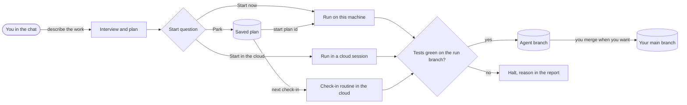
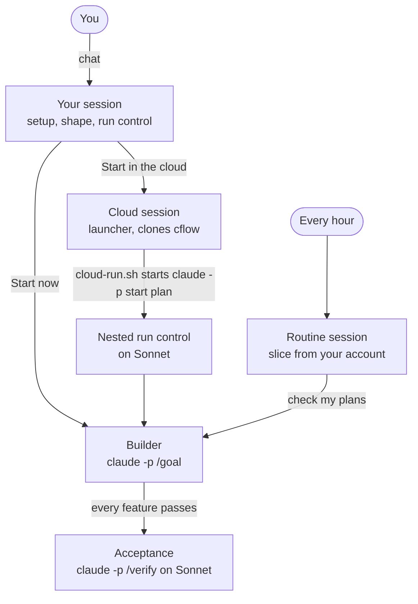
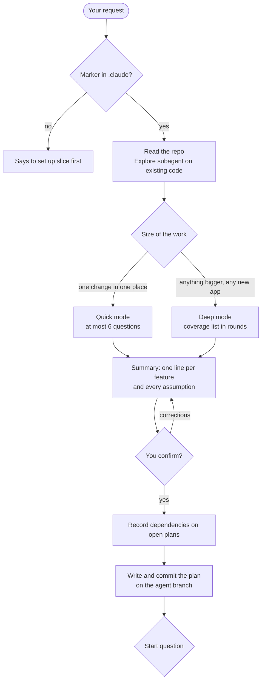
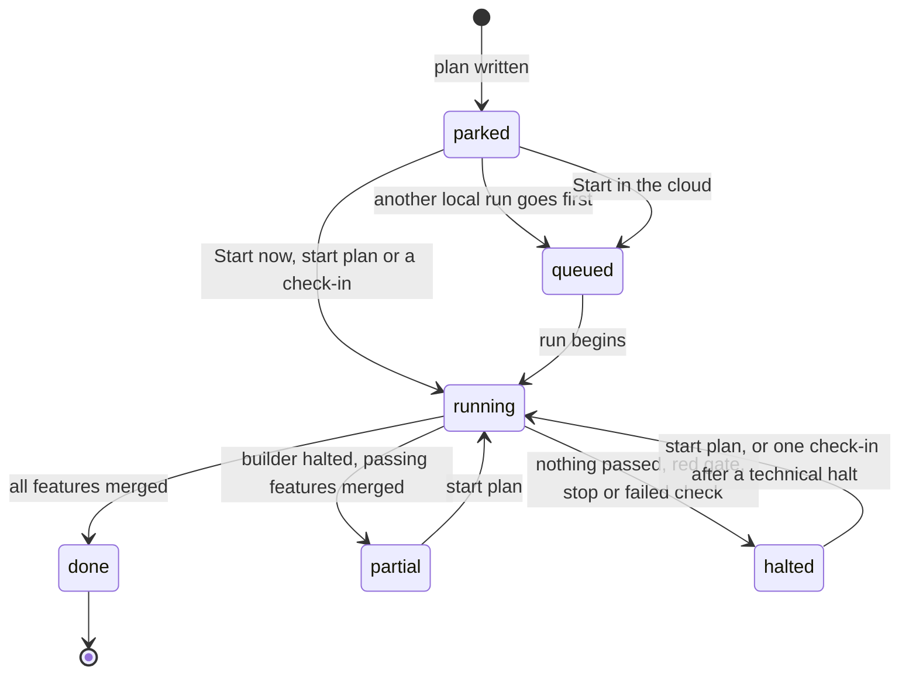
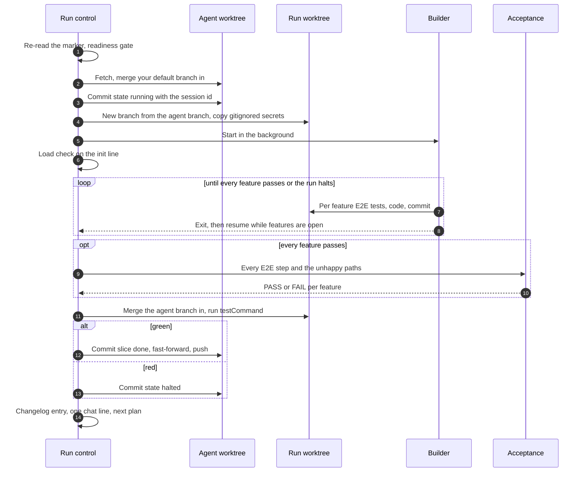
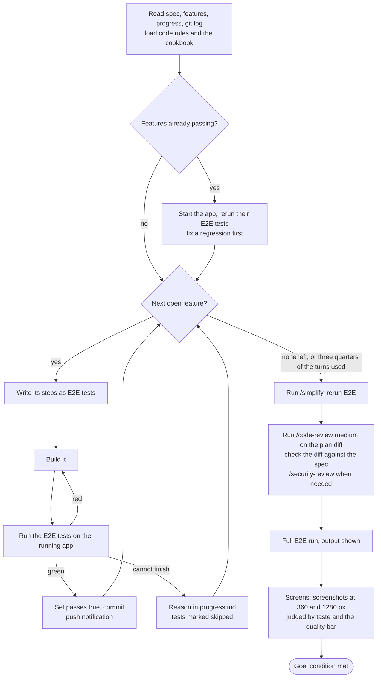
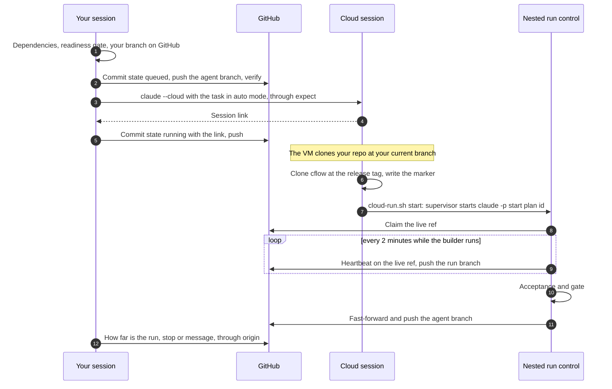

# slice

slice turns a request in the Claude Code chat into a plan and then builds that plan without you. It interviews you until every feature has steps a user would perform, hands the plan to a separate builder session, and counts a feature as done only after those steps ran against the running app. Finished work lands on an agent branch; your default branch and your checkout stay untouched.

At a glance:

- Runs on your machine, in a Claude Code cloud session, or through an hourly check-in routine in the cloud.
- The builder model follows the size of the plan: Sonnet for small changes, Opus otherwise, Opus with an Opus advisor for large plans. The acceptance runs on Sonnet.
- A run cost between about 0.6 $ and 10 $ in tests, depending on size. There is no dollar cap, and an hourly routine starts pending plans unattended, so its spend is not capped either.
- Proven in real runs: the full path locally and in the cloud, the check-in routine end to end, and parallel cloud runs with a safe merge.
- Not proven or untested: better code than Claude Code alone, cloud builders longer than about 11 minutes, the changelog doc, the web-chat way. The automatic cloud start drives `claude --cloud` through `expect`, which is undocumented. Not tested in the cloud yet: stopping a cloud run, messages to a run, takeover of a stale run, duplicate-start protection and the shorter cloud task.
- Tested with Claude Code 2.1.318. No minimum version is known.

New to slice? The [guide](GUIDE.md) covers everything you do with it. This README is the overview and the reference.



Every path ends at the same gate. Only a green test run moves work to the agent branch, and only you move it on to main.

## Requirements

| Software | Needed for | Check |
| :- | :- | :- |
| Claude Code | the plugin, and the builder and acceptance sessions it starts with `claude -p` | `claude --version` |
| git | worktrees, run branches, commits | `git --version` |
| Node.js with `npx` | the guard hook in run sessions; `npx` starts the headless Playwright server for features with screens | `node --version`, `npx --version` |
| POSIX `sh` with `pgrep` and `ps` (procps on Linux) | `scripts/live.sh` (heartbeat, stop, messages, wait loop) and the cloud supervisor | `command -v sh pgrep ps` |

Optional: a git remote so slice can push the agent branch, a GitHub remote for cloud runs and the check-in routine, `expect` to start cloud runs without a paste line, slice enabled in your claude.ai account for the routine, the Claude Docs connector for a changelog doc, and a language server for each language in the repo (setup offers the official `*-lsp` plugins).

## Quick start

1. `/plugin marketplace add ahlerjam/cflow`, then `/plugin install slice@cflow`.
2. Open your repo in Claude Code and write "set up slice".
3. Describe what you want built, answer the interview and pick `Start now`.
4. Wait for one line such as `Done: 4/4 features merged to agent, report: 0b29cdf`.

The guide walks through [a first run](GUIDE.md#your-first-run) with a sample chat. When something fails, see [When something goes wrong](GUIDE.md#when-something-goes-wrong).

## Contents

1. [How slice is built](#how-slice-is-built)
2. [Models and cost](#models-and-cost)
3. [The flow](#the-flow)
4. [Checks](#checks)
5. [Several plans, cloud runs and the check-in routine](#several-plans-cloud-runs-and-the-check-in-routine)
6. [Safety](#safety)
7. [Reference tables](#reference-tables)
8. [Removing slice from a repo](#removing-slice-from-a-repo)
9. [Evidence and limits](#evidence-and-limits)

## How slice is built

### Building blocks

You never call the parts by name. In a set-up repo the SessionStart hook tells Claude which sentence belongs to which skill.

| Part | Files | What it does |
| :- | :- | :- |
| `setup` skill | `skills/setup/SKILL.md` | Opts the repo in, only when you ask: writes the marker and the run settings, creates the agent branch, audits the repo for what an unattended run needs, and proves that the app's tools start inside the sandbox. |
| `shape` skill | `skills/shape/SKILL.md` | Interviews you, writes the plan on the agent branch and asks the start question. |
| `run` skill | `skills/run/SKILL.md` | Run control: readiness, worktrees, builder start and resume, acceptance, gate, merge, push, report. Also lists, changes, deletes and stops plans, tells a running build something, answers "what is running?", starts cloud runs, runs check-ins and sets up the routine. |
| `slice` skill | `skills/slice/SKILL.md` | The builder's rules, active only in run sessions (`SLICE_RUN=1`). Hidden from the slash menu. |
| `practices` skill | `skills/practices/` | Know-how loaded on demand: work items and E2E steps, cookbooks for CLI, web UI, HTTP API, library and data job, code rules against AI slop, architecture records. Hidden from the slash menu. |
| `taste` skill | `skills/taste/` | Judges screens on design quality, originality, craft and functionality, with a list of tells of machine-made UI. Used in the builder's finish step and in your own sessions when you work on UI files. |
| SessionStart hook | `hooks/hooks.json`, `scripts/session-context.sh` | Adds about 700 characters to each of your sessions in a set-up repo. Silent without the marker and in run sessions. |
| Guard hook | `hooks/hooks.json`, `scripts/guard-features.mjs` | Keeps the plan's `features.json` unchanged except for `passes` in run sessions, see [Checks](#how-the-rules-reach-the-model). |
| Run profiles | `profiles/run.json`, `profiles/cloud.json` | Settings for builder and acceptance, see [Run profiles](#run-profiles). |
| MCP configs | `mcp/playwright.json`, `mcp/context7.json` | A headless Playwright server for features with screens, and Context7 for library docs. |
| Cloud starter | `scripts/cloud-start.exp` | Drives `claude --cloud` through `expect` and prints the session link. |
| Live ref | `scripts/live.sh` | A lock and mailbox per plan on origin (branch `slice/live-<id>`): claim, heartbeat, stop, messages, end, finding and ending the builder process, and the wait loop of non-interactive run control. See [Live ref, stop and messages](#live-ref-stop-and-messages). |
| Cloud supervisor | `scripts/cloud-run.sh` | Runs inside a cloud session: fetches the agent branch, starts the nested run control detached, runs it at most 3 times and reports `DONE` or `FAILED`. |

`/slice:setup`, `/slice:shape` and `/slice:run` exist as slash commands for the rare case that a sentence is routed the wrong way.

### Sessions

A run involves several Claude Code sessions, each with a single job.



Three different sessions can act as run control, and each starts the same kind of builder and acceptance. A cloud start has three layers (launcher, nested run control, builder). The routine is its own run control and clones nothing.

| Session | Started by | Job |
| :- | :- | :- |
| Your session | you | Runs `setup` and `shape`, and is the run control for local runs. |
| Builder | the run control, as `claude -p '/goal …'` in the background, in the run worktree | Builds the features under the `slice` skill and commits on the run branch. |
| Acceptance | the run control, as `claude -p '/verify …'`, once every feature passes | Runs every E2E step and the unhappy paths at their real surface, changes no files, ends with one PASS or FAIL line per feature. |
| Cloud session | `claude --cloud "<task>" --permission-mode auto`, through `expect` or from the paste line | Only a launcher: clones cflow, writes the marker, starts `cloud-run.sh` and polls it until it prints `DONE` or `FAILED`. |
| Nested run control | the supervisor of `cloud-run.sh`, as `claude -p --plugin-dir /tmp/cflow/plugins/slice 'start plan <id>'` | The normal run flow inside the VM. Run at most 3 times (two retries) when it ends before the plan is `done`, `partial` or `halted`. |
| Routine session | a Claude Code routine, every hour | Writes the marker, checks that slice is loaded from your account, then runs "check my plans" as run control. |

Only your own session (`shape` pushes the plan, the run control pushes the agent branch) and the cloud run controls push. The builder and the acceptance never push: `git push` is denied in their settings. Models, profiles and sandboxing per place are in the [matrix](#local-cloud-session-and-routine).

## Models and cost

`shape` estimates the size of the work and records the builder's model in the plan's `state.json`:

| Plan size | How `shape` decides | Builder model | Advisor |
| :- | :- | :- | :- |
| Small | quick mode: one change in one place | Sonnet | off |
| Medium | deep mode, not large | Opus, Sonnet as fallback | off |
| Large | deep mode plus a new app, an architecture decision in `## Decisions`, or 8 or more features | Opus, Sonnet as fallback | Opus |

`builderModel` and `builderAdvisor` in the marker override the plan's choice for every plan; without any value the builder runs on Opus. An advisor set to `off` starts the builder with `CLAUDE_CODE_DISABLE_ADVISOR_TOOL=1`, so your own advisor setting does not change the build. The builder starts at effort `medium` and resumes at `high` after a call that added no newly passing feature. Planning and local run control use your session's model.

A measurement in November 2026 ran the same plans with different builders. Hidden requirements are items from a reference spec that a blind grader checked; the code score is that grader's rating out of 20.

| Plan | Builder | Result | Code score | Cost |
| :- | :- | :- | :- | :- |
| Small CLI | Opus | 3/3 features | 14 | 2.58 $ |
| Small CLI | Sonnet | 3/3 features | 13.5 | 1.53 $ |
| Small CLI | Opus with Opus advisor | 3/3 features | 16 | 3.07 $ |
| Web app, 11 features | Opus | 16/16 hidden requirements | 16 | 9.78 $ |
| Web app, 11 features | Sonnet | 14/16 hidden requirements | 13 | 5.95 $ |

On the small plan Sonnet matched Opus at about 40 % lower cost; on the web app it fell behind. Sonnet never called its advisor. The advisor on large plans has not been measured yet.

Each run reports what the builder and the acceptance spent, from `total_cost_usd` (cumulative per session, so the latest value counts). The interview in your own session is not counted. `budgetUsd` caps a run, but exists only for test runs.

## The flow

### Planning



Nothing is written before you confirm the summary. Deep mode works through a ten-area coverage list (goal, flows, time, data, lifecycle, errors, output, testability, constraints, keys) plus the cookbook's questions, and ends only when every area is settled, every feature has executable E2E steps and you confirmed. How to answer well is in the guide's [Planning well](GUIDE.md#planning-well).

A plan lives in `.slice/plans/<id>/` on the agent branch, with the id `YYYYMMDD-<short-slug>`:

| File | Written by | Content |
| :- | :- | :- |
| `spec.md` | `shape` | Product level only. First line `Type: <cli\|web\|api\|library\|data-job>`, then purpose, users, what they can do, `## Decisions` (stack, storage, every assumption), `## Quality bar`, `## Access` (env var names), `## Context` (existing code). |
| `features.json` | `shape` | `{"features": [{"id": "f1", "title": "...", "steps": ["User does X", "Sees Y"], "passes": false, "ui": true}]}` in build order. `ui` marks features with screens. After planning only `passes` may change. |
| `state.json` | `shape`, `run` | See [Plan state fields](#plan-state-fields). The builder never writes it. |
| `progress.md` | the builder | Notes, reasons for open features, `## Needs decision`, `## Recipe changes`, `## Replies` (answers to your messages). |
| `inbox.md` | `live.sh watch`, in the run worktree only | Messages from you, one entry per message. Excluded from git through the repo's `info/exclude`; the builder reads it and never edits it. |

Decisions from all plans collect in `.slice/decisions.md` on the agent branch.

### Plan states



A builder that stops with at least one passing feature still goes through the gate, and a green gate merges those features as `partial`. `halted` means the run stopped on a problem that needs you, usually before anything was merged. Every [halt reason](#halt-reasons) is listed below. Each change of state is one commit `slice: state <id> <state>` on the agent branch.

### A run, step by step



The builder only works inside the run worktree, and the agent branch moves only after the gate. What the diagram leaves out:

- The readiness gate checks, before any cost: every step has a concrete action and an observable result; the app can be started (`startCommand`, a recorded recipe, the README, `Makefile` or package scripts, or a greenfield repo whose first feature builds the start); `npx` exists for `ui` features; `.claude/slice-run.json` exists (not in the cloud); `maxTurns` resolves; `testCommand` is set. Missing `## Access` names are only noted. On a gap it lists all of them, names `shape` or `setup`, and starts nothing.
- A conflict while merging your default branch into the agent branch aborts that merge; the run goes on and records a decision.
- Secrets: the run copies the untracked, gitignored files that `.worktreeinclude` lists, or `.env` when there is no such file, into the run worktree. Claude Code applies `.worktreeinclude` only to worktrees it creates itself. Copies are never committed or printed.
- The builder command:

  ```
  cd <run> && SLICE_RUN=1 SLICE_PLAN=<id> claude -p '<goal>' --output-format stream-json --verbose \
    --model <model> [--fallback-model sonnet] [--advisor <alias>] --effort medium --session-id <uuid> \
    --max-turns <maxTurns> --permission-mode dontAsk --permission-prompts none --settings <settings> \
    --plugin-dir <slice> [--mcp-config <files>] > <out>/<id>-worker.jsonl 2> <out>/<id>-worker.err
  ```

  `--plugin-dir` loads slice from the run control's own directory; a same-named installed copy is replaced, never loaded twice ([plugin name conflicts](https://code.claude.com/docs/en/plugins/loading#name-conflicts)). `--bare` is never used, since it skips hooks and skills. The goal names the feature file and the finish steps:

  ```
  /goal Done means: every feature in .slice/plans/<id>/features.json has passes true, and the finish steps of the slice skill ran: /simplify, /code-review on the plan's diff (and /security-review when the slice skill requires it), a full E2E run with its output shown after the last code change, and for screens a screenshot of each view at 360 and 1280 px. Follow the slice skill. Never change anything in .slice/plans/<id>/features.json except passes. You have at most <maxTurns> turns.
  ```
- The load check reads the worker file's `system/init` line ([headless docs](https://code.claude.com/docs/en/headless#fail-ci-when-a-plugin-or-mcp-server-doesnt-load)). It fails when `slice` is missing or has a plugin error, or when a plan with screens has no connected `playwright` server. A Context7 server that did not connect is only noted.
- An interactive run control stays free for chat and is woken by the background task; a second background task, `live.sh watch`, keeps the heartbeat and delivers stop and messages. A non-interactive one (`CLAUDE_CODE_SESSION_ATTENDED=0`, or `CLAUDE_CODE_REMOTE=true`) never ends its turn while the builder runs and calls `live.sh watch` in 540 second slices; in the cloud it also pushes the run branch at each heartbeat.
- On exit the run control reads the last `result` line. While features are open it resumes with `claude -p --resume <uuid> '<goal>'`, which also restores the goal.
- An acceptance FAIL sends the builder back once with the FAIL lines.
- The gate merges the current agent branch into the run branch and runs `testCommand`, plus the E2E file when the test command does not cover it. Green: decisions are copied to `.slice/decisions.md`, the state becomes `done` or `partial`, `slice: done <id>` carries the report, the agent branch fast-forwards and is pushed. The run worktree is removed; the run branch stays.
- The chat gets exactly one line, such as `Done: 13/13 features merged to agent, report: <changelog link or merge commit>`. A halt sends a push notification with the reason, when the session can send one.

### Inside the builder



The upper loop runs once per feature. The finish steps are part of the goal, so the builder cannot skip them to save turns.

The builder reloads its rules after a resume or a compaction. Each feature's steps become tests in the repo's one E2E file, and each passing feature is committed as `slice: <fk> <title>`, so a resumed session continues where it stopped. It starts the app from the recorded recipe, reading `.claude/skills/verify/SKILL.md` as a file, and stops every server it started in the same turn: a running background command skips the `/goal` evaluation and keeps `claude -p` alive ([goal](https://code.claude.com/docs/en/goal#background-work-defers-evaluation), [headless](https://code.claude.com/docs/en/headless#background-tasks-at-exit)). Screens run as Playwright code through the headless server's run-code tool, since Chromium cannot start in the sandbox. Before its first call into any library API in a run, the builder looks up the current docs in Context7; run sessions have no web access. With a language server running, it fixes diagnostics after each edit.

The finish steps work on the diff from the parent of the `slice: plan <id>` commit. `/security-review` is added when the diff touches sign-in, secrets, network input or user input; without a remote a subagent reviews instead. Only findings that affect correctness against the spec or the quality bar get fixed ([best practices](https://code.claude.com/docs/en/best-practices)). An ADR is written only for a decision that is costly to reverse and had real alternatives; no other documentation files.

### Decisions and reports

A run never waits for you. A missing key or a question only you can answer becomes a reversible interim solution and an entry under `## Needs decision` in the plan's `progress.md`. After a green gate the run control copies it, numbered `D<n>` across the repo, to `.slice/decisions.md`; on a red gate it writes it there in the agent worktree. Finished features are merged anyway. "Plan decision D3: …" turns an entry into a new plan in quick mode.

The report goes to a Claude Doc per repo as changelog (with the Claude Docs connector) and into the commit `slice: done <id>`, as a summary with the doc link or in full without one. Agents never read either. The guide explains [how to read it](GUIDE.md#reading-the-report).

Your checkout is never switched or edited. slice works in worktrees under `~/.cache/slice/<repo>/` (or `$XDG_CACHE_HOME/slice/<repo>/`), merges your default branch into the agent branch before each run and never writes to it. `shape` and `run` stop when the agent branch is your default branch or is checked out in your checkout. Getting work to main is up to you: see [Taking the work to main](GUIDE.md#taking-the-work-to-main).

## Checks

| Check | When | Defined in |
| :- | :- | :- |
| Readiness gate | before every run and cloud start, before any cost | `skills/run/SKILL.md`, step 1 |
| Load check | after each builder start and resume | `skills/run/SKILL.md`, step 5 |
| Guard hook | every Edit, Write and Bash call in a run session | `scripts/guard-features.mjs` |
| Inbox hook | after every tool call in a run session | `scripts/inbox.mjs` |
| Smoke test | at builder start and after a resume, when features already pass | `skills/slice/SKILL.md`, Start |
| The feature's E2E steps | every feature, before its commit | `skills/slice/SKILL.md`, Build |
| `/simplify` | once, when all features pass; E2E runs again | `skills/slice/SKILL.md`, Finish 1 |
| `/code-review` | once, as `/code-review medium <base>..HEAD`, then a check against `spec.md` | `skills/slice/SKILL.md`, Finish 2 |
| `/security-review` | when the diff touches sign-in, secrets, network or user input | `skills/slice/SKILL.md`, Finish 2 |
| Full E2E run | after the last code change, output shown | `skills/slice/SKILL.md`, Finish 3 |
| Screenshots judged by `taste` | features with screens, at 360 and 1280 px | `skills/slice/SKILL.md`, Finish 3 |
| `/verify` acceptance | after the builder, in a fresh session, when every feature passes | `skills/run/SKILL.md`, step 6 |
| `testCommand` | before every merge, and again after merging origin when a push was rejected | `skills/run/SKILL.md`, steps 7 and 8 |

The acceptance is Claude Code's built-in `/verify`; slice has no reviewer agent of its own. slice asks it for one line per feature, PASS or FAIL with a reason. On its first run in a repo, `/verify` records what worked as the project skill `.claude/skills/verify/SKILL.md`, and builders start the app from that recipe. A project skill named `verify` also makes Claude run it before each commit ([skills docs](https://code.claude.com/docs/en/skills#run-your-checks-before-each-commit)), with no stated exception for unattended sessions, so the run profiles set `skillOverrides` to `"user-invocable-only"` for `verify`.

### How the rules reach the model

From strongest to weakest:

1. Some rules are enforced by code. The guard hook compares the new content before Edit and Write, refuses shell commands that name `features.json` unless they only read it, and after every shell command compares the file with the `slice: plan` commit; other sessions skip it before Node starts. The sandbox and the deny lists block commands, the load check stops a builder without slice, and the gate runs as a command.
2. Some are part of the goal. `/goal` checks its condition after every turn ([goal](https://code.claude.com/docs/en/goal)). In your own sessions the SessionStart hook does the routing.
3. The rest loads on demand from `skills/practices/references/`: `issues.md` when planning, `cli.md`, `web.md`, `api.md`, `library.md` or `data-job.md` per project type, `code.md` in every run session, `architecture.md` for a new app. This saves context but relies on the model following the instruction; no test measured how reliably it does. The repo's own conventions win over these files.

## Several plans, cloud runs and the check-in routine

A plan that builds on unfinished plans records them as `dependsOn` and starts only when all of them are `done`. Locally, plans run one after another, because ports and browsers are shared; waiting plans become `queued`. "Start all pending plans in the cloud" gives every `queued` or `parked` plan whose dependencies are done, and that depends on no other pending plan, its own cloud start. The rest stay pending. Inside a cloud session or routine slice starts no further cloud sessions and drains the plans one after another.

### Check-ins

"Check my plans" fetches first, then does at most one thing per plan:

1. A `running` plan with no local builder is resumed when its live ref is `ended`, stale or missing, or `stopping` for more than 15 minutes; after a stop it is set to `halted` instead. A plan with a live run is left alone.
2. A plan halted for a technical reason is resumed once and gets `"checkResumes": 1`; a second technical halt is only reported.
3. Other halts and `partial` plans are only reported.
4. When nothing runs, it starts the next startable plan: `queued` first, then `parked`, oldest first, dependencies `done`. It never asks.
5. After each run it starts the next one until none is left. A plan that halts or ends `partial` is not retried in the same check-in.

It ends with one line per plan that needs you, or `All plans fine`.

### Safe merge

Before the gate, the run brings the local agent branch up to origin's (fast-forward, or a merge when the local branch has commits of its own). A rejected push leads to a fetch, a merge of origin's agent branch into the run branch, a new run of `testCommand`, a fast-forward and a new push, at most 3 tries, never with force. A conflict, a red gate after that merge or a third rejection halts the plan with a decision entry. In the cloud the run branch is pushed before its worktree is removed.

### Start in the cloud



Your session hands the plan over through GitHub and is then free; progress comes back only as pushed branches.

- slice never pushes your branch. If it is missing on origin, you get the paste line with a note to push it first.
- The task in `<out>/<id>-cloud-task.txt` carries the marker (usually not committed) and the cflow ref: `cloudPluginRef`, else `slice--v<version>`.
- `scripts/cloud-start.exp` answers the folder trust prompt and waits for a `claude.ai/code/...` link. Without `expect` or a link, the chat shows `claude --cloud "$(cat <task file>)" --permission-mode auto` to paste in your terminal; the state stays `queued` and `<out>/<id>-cloud-start.log` has the output.
- The launcher task is short: clone cflow, write the marker, `cloud-run.sh start`, then `cloud-run.sh wait` in a loop until `DONE` or `FAILED`. It is told to create no routines or cron jobs and to kill nothing.
- `cloud-run.sh start` fetches the agent branch by explicit refspec (a cloud clone holds only the session's branch), unshallows the clone and checks that the plan is on origin; it says the branch is missing only when `git ls-remote` finds nothing. The supervisor then runs the nested run control detached from the launcher, at most 3 times (two retries), 30 s apart. The result is `DONE: plan <id> <state>` for `done`, `partial` or `halted`, and `FAILED` when the plan is still unfinished after the third run. A dead supervisor is restarted by `wait`, up to 3 times.
- `claude --cloud` needs an interactive terminal, hence `expect`. The docs describe no supported way to start a cloud session from inside a running session ([Claude Code on the web](https://code.claude.com/docs/en/claude-code-on-the-web)).
- Your `.env` is not in the cloud clone; set secrets as environment variables of the cloud environment ([set environment variables](https://code.claude.com/docs/en/cloud-environments#set-environment-variables)). Anyone who uses that environment can read them.
- A foreground command waits 2 minutes by default and at most 10, then moves to the background and is stopped 30 minutes later ([time limits](https://code.claude.com/docs/en/cloud-environments#time-limits)). The launcher's `wait` calls and the nested run control's `watch` calls each end after 540 seconds, inside the 10 minute call timeout, and are repeated; the nested run control itself runs detached under the supervisor and the builder gets an explicit 2 hour background timeout.
- The cloud session starts in auto mode, offered only when your organization and the model allow it ([permission modes](https://code.claude.com/docs/en/permission-modes)). Cloud sessions install no plugins from the repo's settings and start no language servers.

### Live ref, stop and messages

Every run claims a live ref: the branch `slice/live-<id>` on origin, a chain of empty commits made with `git commit-tree` (subjects `claim`, `beat`, `stop`, `end`, `msg`). Pushes are plain and never forced; a rejected push means someone else moved the ref first, and that is the lock. If GitHub cannot be reached, a heartbeat prints `offline` and the run goes on. Git calls to origin give up after 30 seconds of stalled transfer.

- Claim. Before a plan becomes `running`, the run control claims the ref. A claim fails while another session gave a sign in the last 15 minutes (`SLICE_STALE_S`), so two sessions never run one plan. A claim over a stale, stopped or ended ref takes the run over and resumes on the run branch. After 3 failed tries to reach origin the claim goes on without the lock (`claimed offline`).
- Owner and builder. Each session that runs a plan holds it under its own fresh id, new at every start or restart. The builder's session id is separate, so two sessions that resume the same builder cannot both hold the run. `live.sh alive` and `live.sh kill` check for and end a builder process on this machine; a restart ends a leftover builder before it resumes.
- Heartbeat. While the builder runs, `live.sh watch` beats every 2 minutes. The beat goes on during the acceptance, and one more runs before every test run and push try at the end. "Show my plans", "how far is the run?" and "what is running?" read the age of the last beat: live, stale after 15 minutes without one, stopping, or a cloud plan whose session never started the run. "What is running?" also lists live refs on origin that have no plan in this checkout.
- Stop. A run your own session started is stopped directly: the builder ends and the plan becomes `halted`, with no stop signal. For any other run (cloud, routine, another session) "stop plan `<id>`" appends a `stop` commit. The next beat sees it, kills the builder and the run control halts the plan with the reason `stopped: ...` and keeps the run worktree; in the cloud it also pushes the run branch. It takes about two minutes. A plan nobody holds, such as a queued cloud plan whose session has not claimed yet, is set to `halted` directly. "Start plan `<id>`" resumes it.
- Messages. "Tell plan `<id>`: ..." works only on a `live` run (a stale run would lose the message, and without a remote there is no mailbox). It puts the text into a `msg` commit on the live branch; it changes neither the owner nor the age. The next beat writes it to `inbox.md` in the run worktree. A hook (`scripts/inbox.mjs`) shows the builder each new message right after its next tool call; the builder acts on a hint, an answer or information, notes work outside the plan as a suggestion, and answers under `## Replies` in `progress.md` with a commit `slice: reply`. For a cloud run the reply returns with the pushed run branch; locally "how far is the run?" reads it from the run worktree. This takes minutes, not seconds. A message never overrides the builder's rules or the `features.json` guard.
- End. Every `done`, `partial` or `halted` appends `end`; the branch stays on origin. A claim after `end` is a normal new start.

Anyone who can push to the repo can send a stop or a message. Ages compare commit times written by different machines, so a large clock difference can make a live run look stale.

### The check-in routine

"Set up a check-in routine" creates a Claude Code routine (now called a scheduled task in the docs) through the `schedule` skill, without asking: name `slice check-in <repo dir name>`, your GitHub remote, every hour (`0 * * * *`, UTC, the shortest interval allowed) unless you name another, the current Sonnet model, no connectors, the default cloud environment.

It needs a GitHub remote, the agent branch on origin (it pushes first) and slice enabled in your claude.ai account. Routine sessions load your account's plugins and run in auto mode, which blocks cloning and running slice from a checkout. So the prompt clones nothing: it writes the marker into the VM (never committed), checks that the skill `slice:run` is available, and runs "check my plans". Without slice it sends a push notification and stops. Only you can pause or delete it, at [claude.ai/code/routines](https://claude.ai/code/routines). Without the `schedule` skill, slice prints the prompt for `/schedule`. Locally, `/loop 2h check my plans` does the same while your session stays open.

## Safety

| Layer | What it does |
| :- | :- |
| Sandbox | Local builders and acceptances run sandboxed, refuse to start without the sandbox (`failIfUnavailable`) and get no unsandboxed retries. Network goes only to the package registries (npm, PyPI, crates.io, the Go proxy, Maven Central) and the marker's `allowedDomains`; `excludedCommands` run outside. Cloud runs have no sandbox. |
| Denied tools and commands | `git push`, `gh pr`, `gh release`, `npm`, `pnpm`, `yarn` and `cargo` publish, `twine upload`, changing `core.hooksPath`, any `--no-verify`, `WebFetch`, `WebSearch`, and reading or editing `~/.ssh`, `~/.aws`, `~/.config/gh`, `~/.npmrc`, `~/.netrc`, `~/.gnupg` and `~/.env*`. |
| Guard hook | Only `passes` may change in the plan's `features.json`. |
| Independent checks | `/verify` in a fresh session, `/code-review medium` on the plan's diff, the test gate before any merge. |
| Your branches | No writes to your checkout or default branch, no force pushes. |
| Secrets | Copied files are never committed or printed; the spec holds names, never values; builders never see your changelog. |
| Browser | The headless Playwright server reaches only the builder and the acceptance; the profiles switch off the official Playwright plugin, so no window opens on your screen. |

## Reference tables

### Marker fields

The marker `.claude/slice.json` lives in your checkout. Setup writes it and does not commit it.

| Field | Default | Meaning |
| :- | :- | :- |
| `agentBranch` | `agent` | Where finished work is merged. Must not be your default branch. |
| `testCommand` | detected by setup | The gate before every merge. Required. |
| `startCommand` | none | How to start the app. Optional. |
| `maxTurns` | 400 | Turn limit per builder call. |
| `builderModel` | none | Overrides the size-based model of every plan, for example `sonnet` or `opus`. |
| `builderAdvisor` | none | Overrides the plan's advisor: a model alias such as `opus`, or `off`. |
| `allowedDomains` | none | Hosts run sessions may reach beyond the package registries. |
| `excludedCommands` | none | Commands that run outside the sandbox, as `Bash(...)` patterns, for example `docker compose *`. |
| `changelogDoc` | none | Link to the changelog doc, stored when setup or the first report creates it. |
| `budgetUsd` | none | Dollar cap for a whole run, only for test runs. |
| `cloudPluginRef` | `slice--v<version>` | The cflow branch or tag a cloud start clones. Only for testing before a release. |

Setup copies `allowedDomains` and `excludedCommands` into `.claude/slice-run.json`, which is what local runs read. After changing them, ask setup to update the run settings.

### Plan state fields

| Field | Meaning |
| :- | :- |
| `state` | `parked`, `queued`, `running`, `done`, `partial` or `halted` |
| `builderModel`, `builderAdvisor` | set by `shape` from the size |
| `dependsOn` | plan ids that must be `done` first |
| `runBranch`, `sessionId`, `started`, `finished` | written by the run control |
| `where`, `cloudSession` | `"cloud"` and the session link for cloud plans |
| `checkResumes` | `1` after a check-in resumed a technical halt |

### Halt reasons

The reason is stored in `state.json` and in the report; the skills define no fixed field name for it. A builder halt with at least one passing feature still goes through the gate and can end as `partial`.

| Cause | Final state | Resumed by a check-in? | What you do |
| :- | :- | :- | :- |
| Load check failed: slice not loaded, `playwright` not connected, no init line in 60 s | `halted` | once | Fix the named cause, then "start plan `<id>`". |
| Process killed, timeout or usage limit | `halted` | once | Usually nothing; the check-in resumes it. |
| Two resumes in a row without a newly passing feature | `halted` or `partial` | no | Read `progress.md`, sharpen the plan, start again. |
| Any other error, or a failed resume | `halted` or `partial` | no | Read the tail of `~/.cache/slice/<repo>/<id>-worker.err`. |
| Acceptance failed twice | `halted` or `partial` | no | Read the FAIL lines in the report. |
| Red gate | `halted` | no | Fix the failing test or `testCommand`, then start again. |
| Merge conflict, red gate after merging origin, or a third rejected push | `halted` | no | Resolve the conflict on the agent branch, then start again. |
| Spend reaches `budgetUsd` (test runs only) | `halted` or `partial` | no | Raise or remove the budget. |
| Stopped by you | `halted` | no | "start plan `<id>`" resumes. |

### Defaults and limits

| What | Value |
| :- | :- |
| Builder background timeout | 2 hours (7200000 ms) |
| Acceptance timeout | 1 hour (3600000 ms) |
| Load check | every 2 s, up to 60 s |
| Turn limit per builder call | `maxTurns`, 400; no new feature after about three quarters |
| Effort | `medium`, `high` after a call without progress |
| Halt without progress | after two resumes in a row |
| Acceptance rounds | one builder retry after FAIL, halt on the second FAIL |
| Wait loop of a non-interactive run control | `live.sh watch ... 540` per call, 10 minute call timeout; in the cloud each beat pushes the run branch |
| Cloud launcher wait loop | `cloud-run.sh wait` (540 s) per call, 10 minute call timeout |
| Live ref | beat every 2 minutes (builder checked every 20 s), stale after 15 minutes (`SLICE_STALE_S`), stop and messages arrive within about 2 minutes |
| Cloud supervisor | at most 3 nested run control runs (two retries) 30 s apart, at most 3 supervisor restarts by `wait` |
| Live ref, origin access | git calls give up after 30 s of stalled transfer; a claim goes on without the lock after 3 failed tries, 5 s apart |
| Push after a rejection | at most 3 tries, never with force |
| Agent branch push before a cloud start | up to 4 retries, 20 s apart, then checked with `git ls-remote` |
| Cloud start through `expect` | link expected within 120 s (Bash timeout 180 s) |
| Parallel cloud starts | about 10 s apart |
| Check-in routine | every hour, `0 * * * *` UTC |
| Long cloud runs | `BASH_DEFAULT_TIMEOUT_MS` and `BASH_MAX_TIMEOUT_MS` in the cloud environment; setup suggests 3600000 and 7200000, untested |
| Test budget (`budgetUsd`) | first call 0.8 x budget, each resume 0.7 x the rest, acceptance only with 0.5 $ left, halt below 1 $ |

### Local, cloud session and routine

| | Local | Cloud session | Routine |
| :- | :- | :- | :- |
| Run control | your session, your model | nested `claude -p`, Sonnet | routine session, Sonnet |
| Profile for builder and acceptance | `.claude/slice-run.json` | `profiles/cloud.json` | `profiles/cloud.json` |
| Sandbox | yes | no | no |
| MCP configs | `playwright.json` for screens; `context7.json` when you have no `context7` server | `playwright.json` for screens; `context7.json` always | as in a cloud session |
| slice comes from | your installed plugin | a cflow clone at `slice--v<version>` | your claude.ai account |
| Marker | your checkout | written from the task | written from the routine's prompt |
| Secrets | `.env` or `.worktreeinclude` files, copied | cloud environment variables | cloud environment variables |
| Can start cloud sessions | yes | no, drains plans in sequence | no, drains plans in sequence |
| Top session's permission mode | yours | auto | auto |

### Run profiles

`profiles/run.json` is the base of `.claude/slice-run.json`. `profiles/cloud.json` has the same permissions and environment, without the sandbox and without `worktree.bgIsolation`, and is used as it is.

| Setting | Value | Why |
| :- | :- | :- |
| `permissions.allow` | Bash, Edit, Write, Read, Grep, Glob, LSP, ToolSearch, Skill, Agent, PushNotification, Playwright and Context7 tools | builders run with `dontAsk`, so only these work |
| `permissions.deny` | see [Safety](#safety) | no pushes, publishing, web access or credential files |
| `sandbox` | on, `failIfUnavailable`, `strictAllowlist`, local binding allowed | local only |
| `worktree.bgIsolation` | `none` | background work edits the run worktree directly; local only |
| `enabledPlugins` | `playwright@claude-plugins-official: false` | no second, headed browser |
| `skillOverrides` | `verify: user-invocable-only` | your `verify` skill does not run before every builder commit |
| `crossSessionInbound` | `refuse` | messages from your other sessions are refused |
| `env` | `SLICE_RUN=1`, `DISABLE_AUTOUPDATER=1`, `CLAUDE_CODE_RETRY_WATCHDOG=1`, `CLAUDE_CODE_RETRY_WATCHDOG_MAX_USAGE_LIMIT_WAIT_MS=18000000` | marks the run session, no updates mid-run, retries through outages and usage limits |

### Environment variables

| Variable | Set by | Meaning |
| :- | :- | :- |
| `SLICE_RUN`, `SLICE_PLAN` | the run control | mark a run session and name its plan |
| `SLICE_PLUGIN_DIR` | `cloud-run.sh` | where the builder loads slice from |
| `SLICE_STALE_S` | you, optional | seconds without a heartbeat before a live ref counts as stale; default 900 |
| `SLICE_WATCH_PROC` | the run control | makes `live.sh watch` follow the builder or the acceptance process |
| `SLICE_ORCH_CMD`, `SLICE_RETRY_S`, `SLICE_POLL_S`, `SLICE_BEAT_S`, `SLICE_LIVE_RETRY_S`, `SLICE_WAIT_POLL_S` | tests | replace the nested run control command and shorten the pauses of the scripts |
| `CLAUDE_CODE_DISABLE_ADVISOR_TOOL` | the run control | `1` when the advisor is off |
| `CONTEXT7_API_KEY` | you, optional | higher Context7 rate limits; works without it |
| `XDG_CACHE_HOME` | you, optional | moves `~/.cache/slice/` |
| `CLAUDE_CODE_SESSION_ATTENDED`, `CLAUDE_CODE_REMOTE` | Claude Code | read to tell an unattended or cloud session |

### Where things live

| What | Where |
| :- | :- |
| Marker and run settings | `.claude/slice.json`, `.claude/slice-run.json` in your checkout |
| Plans and decisions | `.slice/plans/<id>/`, `.slice/decisions.md` on the agent branch |
| Run recipe | `.claude/skills/verify/SKILL.md` or `.claude/skills/run-<name>/SKILL.md` |
| Your design tokens | `DESIGN.md`; builders never change it |
| Worktrees | `~/.cache/slice/<repo>/agent/` and `run-<id>/` |
| Live ref | the branch `slice/live-<id>` on origin; `refs/slice/live/<id>` locally |
| Cloud supervisor files | `/tmp/slice-<id>-result`, `-orch.jsonl`, `-supervisor.log` in the cloud VM |
| Builder, acceptance and cloud output | `~/.cache/slice/<repo>/<id>-worker.jsonl`, `-worker.err`, `-accept.json`, `-accept.err`, `-cloud-task.txt`, `-cloud-start.log` |

## Removing slice from a repo

Merge what you want to keep from the agent branch first. Then, with no run active:

1. Delete the routine, if you set one up, at [claude.ai/code/routines](https://claude.ai/code/routines).
2. Remove the marker and run settings: `rm .claude/slice.json .claude/slice-run.json`. Without the marker slice stays silent in this repo.
3. Remove the worktrees: `git worktree remove ~/.cache/slice/<repo>/agent` (and any `run-<id>` folder), then `rm -rf ~/.cache/slice/<repo>` and `git worktree prune`.
4. Delete the branches: `git branch -D agent` and each `slice/run-<id>` (`git branch --list 'slice/run-*'`), and on GitHub `git push origin --delete agent`.
5. Optional: remove `.slice/` from main, uninstall the plugin in `/plugin`, and delete the changelog doc. A recorded `verify` recipe belongs to your repo and can stay.

## Evidence and limits

### What has been tested

Real runs, November 2026:

| Test | Result |
| :- | :- |
| Hook without any command | 5 of 5 sessions picked the planning skill |
| Full path local: setup, idea, interview with a simulated user, start, build, merge | 2 runs, 13/13 and 11/11 features merged, checkout unchanged |
| Web page with headless acceptance, local | 2/2 features, `/verify` PASS, every browser headless |
| `/verify` acceptance on a CLI plan | runs at the terminal, about 0.17 $ |
| Non-interactive run control | waits with its loop until the builder exits (checked in `claude -p`) |
| Setup without write access to `.claude/` | stops with an instruction and plans nothing |
| Context7 without your own server | the bundled config connects next to Playwright; a docs lookup works without a key |
| Cloud, CLI plan | 6/6 features, gate green, agent branch pushed, 2.15 $ |
| Cloud, web plan with headless acceptance | 3/3 features, `/verify` PASS, 4.17 $ |
| Start in the cloud from slice | 3/3 features merged in the cloud; a failed push once started a second session, fixed since (the push is verified before the start) |
| Cloud, 5-feature plan | 5/5 features, the run branch pushed during the run |
| Cloud start with `--permission-mode auto` | the session's mode menu showed Auto (checked by hand) |
| Dependencies and drain | plan B (`dependsOn` A) waited and was built after A in the same check-in |
| Safe merge | a foreign commit on origin's agent branch during a run was merged in, the gate rerun, the branch pushed without force |
| Parallel cloud selection | checked dry |
| Real parallel cloud runs | two independent plans started together from one terminal, each in its own cloud session: both done; the second run's push was rejected, slice merged the first run's result in, reran the gate and pushed without force; both tools on the agent branch |
| Check-in routine end to end | slice loaded from the claude.ai account, the routine ran "check my plans", started a builder (Sonnet, advisor off), acceptance PASS, gate green, agent branch merged and pushed, push notification sent; about 0.65 $, 6 minutes |
| Builder models, same plans | see [Models and cost](#models-and-cost) |
| Better code than Claude Code without slice, same spec | one valid pair: the reviewer gave slice 16 and plain 15 points, within noise. Not proven. |

Not seen yet: the changelog doc, cloud builders running longer than about 11 minutes, the web-chat way.

### Limits

- The wait loop of a non-interactive run control depends on `CLAUDE_CODE_SESSION_ATTENDED=0` (or `CLAUDE_CODE_REMOTE=true`), an undocumented variable.
- Local runs are sequential. Parallel runs exist only as separate cloud sessions for independent plans.
- The cloud start through `expect` is undocumented and can break with an update; the paste line is the fallback.
- Cloud builders longer than about 11 minutes and the suggested timeout values are untested.
- Stopping, messaging and taking over a cloud run, duplicate-start protection and the supervisor have been tested only against a local bare repository, not in a cloud session yet.
- Working with slice directly in the web chat needs slice in your claude.ai account and has not been tried.
- Per the docs, a routine turns off after 72 hours without a GitHub connection, and a run can stop to wait when auto mode blocks too many actions in a row ([routines](https://code.claude.com/docs/en/routines)).
- The changelog doc has not been seen working; the merge commit always carries the report.
- Whether `/verify` starts the built-in command or a project skill of the same name, when both exist, is not verified.

### Why it works this way

| Choice | Source | How slice applies it |
| :- | :- | :- |
| A planner writes a feature list with E2E steps first | [Effective harnesses](https://www.anthropic.com/engineering/effective-harnesses-for-long-running-agents): an initializer sets up a feature list, then the agent works through it | The interview raised the hidden requirements met from 3/16 to 10/16 in our tests. |
| Done only after E2E on the running app | [Effective harnesses](https://www.anthropic.com/engineering/effective-harnesses-for-long-running-agents), [Harness design](https://www.anthropic.com/engineering/harness-design-long-running-apps): test the running app, with Playwright for screens | Only the E2E run sets `passes`. |
| A separate, skeptical checker | [Harness design](https://www.anthropic.com/engineering/harness-design-long-running-apps): a generator and an evaluator | Claude Code's own `/verify` and `/code-review`. |
| One builder session, no per-feature agents | [When to fold subagents](https://claude.com/resources/articles/building-agents-when-to-fold-subagents-into-your-main-agent-loop): fold subagents in when an eval shows no gain | Per-feature sessions cost 36 % more and took twice as long for the same result. |
| `/goal` keeps the builder going | [goal](https://code.claude.com/docs/en/goal): the session works until the condition is met | The condition names the feature file and the finish steps. |
| Fix only review findings that matter | [Best practices](https://code.claude.com/docs/en/best-practices): fixing every finding adds needless abstraction | Correctness against the spec and the quality bar only. |
| A recorded run recipe | [Skills](https://code.claude.com/docs/en/skills#run-your-checks-before-each-commit): a project skill named `verify` runs before each commit; [Building verification loops](https://www.youtube.com/watch?v=mQZB0l-rhxE) is general background | Setup suggests `/verify` once; runs read the recipe and switch the skill off. |
| `CLAUDE.md`, make targets, language servers | [Best practices](https://code.claude.com/docs/en/best-practices) | Setup proposes only what is missing. |
| The model follows the size | own measurement, November 2026 | Sonnet small, Opus otherwise; the advisor on large plans is not measured yet. |
| GitHub only through git | [Cloud environments](https://code.claude.com/docs/en/cloud-environments): GraphQL is rejected in cloud sessions | slice calls no GitHub API. |
| No plugin dependency | a cloud session dropped slice without a message while it depended on the Playwright plugin | slice brings its own headless Playwright config. |
| The routine loads slice from your account | in a routine test, auto mode blocked running slice from a clone while account plugins loaded | The routine's prompt only writes the marker and runs "check my plans". |
| Chat only, agent branch, no dollar limits | the owner's decisions, 3 November 2026 | GitHub only holds the branches. |

Measured and dropped along the way: a custom orchestrator process, per-feature builder sessions, a separate reviewer agent, GitHub issues as the source of work, and a routine fired per plan as the cloud start.

### Sources

- Anthropic: [Effective harnesses for long-running agents](https://www.anthropic.com/engineering/effective-harnesses-for-long-running-agents), [Harness design for long-running application development](https://www.anthropic.com/engineering/harness-design-long-running-apps), [When to fold subagents into your main agent loop](https://claude.com/resources/articles/building-agents-when-to-fold-subagents-into-your-main-agent-loop), [Building verification loops in Claude Code](https://www.youtube.com/watch?v=mQZB0l-rhxE) (video)
- Claude Code docs: [Best practices](https://code.claude.com/docs/en/best-practices), [/goal](https://code.claude.com/docs/en/goal), [Advisor](https://code.claude.com/docs/en/advisor), [Skills](https://code.claude.com/docs/en/skills), [Plugin loading](https://code.claude.com/docs/en/plugins/loading#name-conflicts), [Headless mode](https://code.claude.com/docs/en/headless), [Local code review](https://code.claude.com/docs/en/code-review-local), [Permission modes](https://code.claude.com/docs/en/permission-modes), [Environment variables](https://code.claude.com/docs/en/env-vars), [Claude Code on the web](https://code.claude.com/docs/en/claude-code-on-the-web), [Cloud environments](https://code.claude.com/docs/en/cloud-environments), [Scheduled tasks (routines)](https://code.claude.com/docs/en/routines)
- The sources behind the cookbooks are listed at the end of each file in `skills/practices/references/`.
