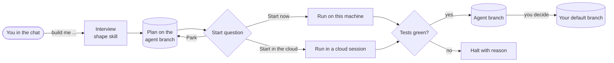
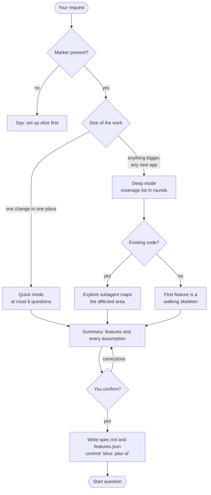
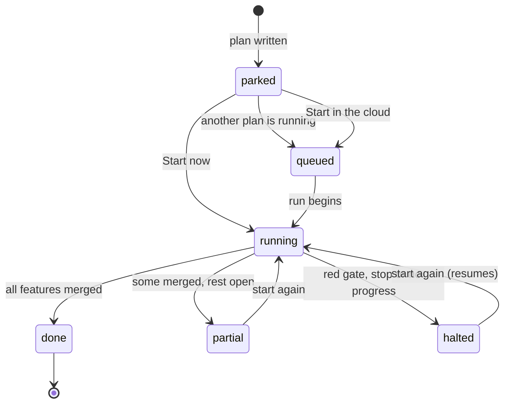
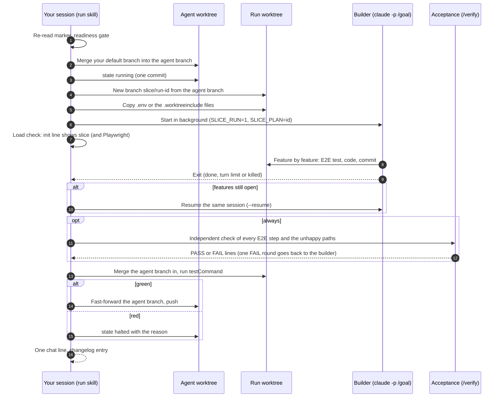
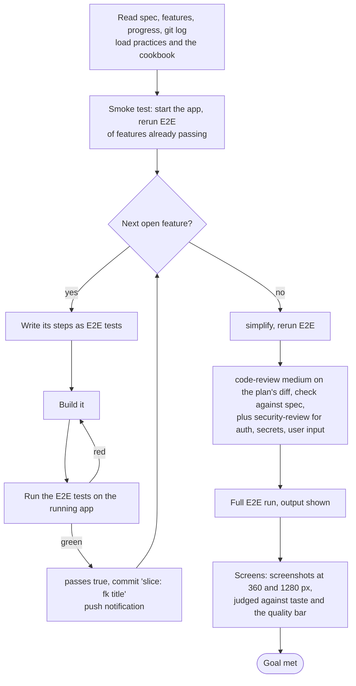
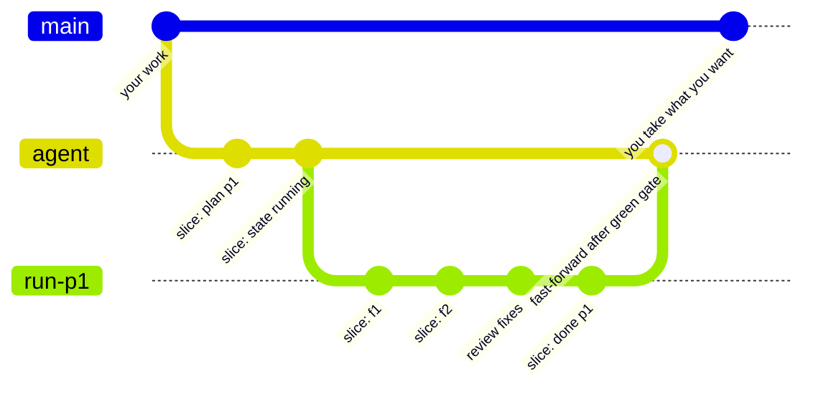
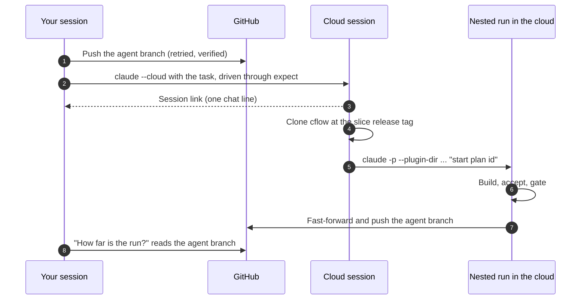

# slice

slice plans work with you in an interview and then builds it unattended. A feature counts as done only after its end-to-end steps ran against the running app. Finished work is merged to an agent branch, never to your default branch. You talk to slice only in the Claude Code chat: no commands, no GitHub issues, no labels. Runs go on your machine or in a Claude Code cloud session.

New here? Start with the short [GUIDE](GUIDE.md). This file explains how it works, why it works that way, what has been tested, and where to read more.

## Requirements

| Software | Needed for | Check |
| --- | --- | --- |
| Claude Code | the plugin and the builder sessions | `claude --version` |
| git | worktrees, run branches, commits | `git --version` |
| Node.js | the guard hook of run sessions; `npx` starts the headless Playwright server for features with screens | `node --version`, `npx --version` |

Library docs: builders look up every library they use in Context7. slice brings its own Context7 server config (`mcp/context7.json`) and uses it when you have none, also in the cloud; set `CONTEXT7_API_KEY` for higher rate limits. Optional: a language server for each language in the repo, used by the official `*-lsp` plugins that setup offers; a git remote for pushing the agent branch, a GitHub remote for cloud runs, `expect` for starting cloud runs automatically, and the Claude Docs connector for the changelog.

## Contents

1. [The idea in one picture](#the-idea-in-one-picture)
2. [Setup](#setup)
3. [Talking to slice](#talking-to-slice)
4. [Planning](#planning)
5. [The start question and plan states](#the-start-question-and-plan-states)
6. [A run, step by step](#a-run-step-by-step)
7. [Inside the builder](#inside-the-builder)
8. [Checks and how the rules reach the model](#checks-and-how-the-rules-reach-the-model)
9. [Branches and merging](#branches-and-merging)
10. [Decisions instead of questions](#decisions-instead-of-questions)
11. [Reports](#reports)
12. [Cloud runs](#cloud-runs)
13. [Safety](#safety)
14. [Where things live](#where-things-live)
15. [What has been tested](#what-has-been-tested)
16. [Why it works this way](#why-it-works-this-way)
17. [Limits](#limits)
18. [Sources](#sources)

## The idea in one picture



Three roles carry the work, following the pattern Anthropic describes for long-running agents ([Effective harnesses](https://www.anthropic.com/engineering/effective-harnesses-for-long-running-agents), [Harness design](https://www.anthropic.com/engineering/harness-design-long-running-apps)):

| Role | In slice | What it does |
| --- | --- | --- |
| Planner | the `shape` skill in your session | turns your idea into a spec and a feature list with E2E steps |
| Builder | a separate `claude -p "/goal …"` session | builds one feature after another and proves each one on the running app |
| Skeptical checker | Claude Code's `/verify`, `/code-review` and the test gate | checks the result independently before anything is merged |

## Setup

1. Install from the cflow marketplace: `/plugin install slice@cflow`.
2. In the repo, ask Claude to "set up slice" or "richte slice in diesem Repo ein".

Setup only runs when you ask. It:

- writes the marker `.claude/slice.json` (agent branch, test command, start command, turn limit, network domains)
- creates the agent branch (`agent` by default) and the run settings `.claude/slice-run.json`
- audits the repo for what an unattended run needs: one command each to start, test and lint, a short `CLAUDE.md`, a recorded run recipe (it suggests Claude Code's `/verify` once; see [Why it works this way](#why-it-works-this-way) for what a project skill named `verify` does), the secrets a run needs, language server plugins, an architecture record for new apps
- checks inside the sandbox that the app's tools start

Setup never commits on your default branch. A new app's scaffold goes on the agent branch; only an empty repo gets one initial commit with a README. If `.claude/` is not writable (for example in `claude -p --permission-mode dontAsk`), setup stops and says what to allow or which two files to create.

In a repo without the marker, slice stays silent and Claude works as usual.

## Talking to slice

In a set-up repo a SessionStart hook tells Claude that slice is active. Then you just write:

| You write | What happens |
| --- | --- |
| "Build me a page where I track my house plants" | interview, summary, start question |
| "Fix: empty files should print 0" | short interview (quick mode), then the start question |
| "Show my plans" / "zeig meine Pläne" | every plan with its state and progress |
| "Start plan 20261104-plants" | runs a parked plan |
| "Start plan 20261104-plants in the cloud" | runs it in a cloud session |
| "How far is the run?" | features passed of total, last commit |
| "Stop the run" | stops the builder and keeps its work for a later resume |
| "Plan decision D2: use Postgres" | turns an open decision into a new plan |
| "Check my plans" | starts queued plans, resumes runs that stopped for technical reasons once, reports the rest |
| "Set up a check-in routine" | prints a prompt for a Claude Code routine (`/schedule`) that runs "check my plans" in the cloud on a schedule |

The slash commands `/slice:setup`, `/slice:shape` and `/slice:run` do the same and stay as a back door.

## Planning



Deep mode ends only when every area of the coverage list is settled, every feature has executable E2E steps and you confirmed the summary. The coverage list:

1. Goal, users, how they notice it works
2. Core flows and their variants
3. Time and dates
4. Data, import and export
5. Lifecycle: edit, undo, duplicates, delete
6. Errors and messages
7. Output: views, empty and long data, exact texts
8. Testability: how a test fixes time, data location and other inputs
9. Hard constraints: platform, install, performance, privacy
10. Keys and access: env var names (never values) go under `## Access` in the spec

The `practices` skill adds coverage questions per project type (CLI, web UI, HTTP API, library, data job), a quality bar, rules for good work items, and code rules against AI slop.

A plan has two files:

- `spec.md` stays at product level: type, purpose, users, `## Decisions` (stack, storage and every assumption, so the builder never guesses), `## Quality bar` and `## Access`.
- `features.json` lists the features in build order, each with steps a user does and sees, concrete enough to run with real data. Features with screens are marked `ui`. Only `passes` changes after planning.

## The start question and plan states

After the plan is written, Claude asks once: `Start now`, `Start in the cloud` (only with a GitHub remote), `Park` or `Plan another task`. Every plan is saved, so you can start it later.



Each state change is one commit `slice: state <id> <state>` on the agent branch.

## A run, step by step



Before any cost, the readiness gate checks that every step has a concrete action and an observable result, that the app can be started, that `npx` is there for features with screens, that the run settings and the test command exist, and that the turn limit resolves. Missing env names from `## Access` are noted, not blocking. On a gap it lists everything and stops.

The run copies your gitignored secrets into the run worktree: the files `.worktreeinclude` lists (`.gitignore` syntax, only files that are gitignored and untracked), or `.env` when there is no such file. Claude Code applies `.worktreeinclude` only to worktrees it creates itself, so slice copies by hand. Copied files are never committed. In the cloud they do not exist; set the secrets as environment variables of the cloud environment. A name under `## Access` counts as present when it is in the environment or in a file that gets copied.

The builder runs with `--output-format stream-json --verbose` into `<id>-worker.jsonl` and always gets `--plugin-dir` for slice itself; a same-named installed copy is replaced, not loaded twice ([plugin name conflicts](https://code.claude.com/docs/en/plugins/loading#name-conflicts)). Right after the start the run reads the first `system/init` line ([headless docs](https://code.claude.com/docs/en/headless#fail-ci-when-a-plugin-or-mcp-server-doesnt-load)). If `slice` is not among the loaded plugins, or a run with screens has no connected `playwright` server, it stops the builder and halts with that reason. The result, cost and refused commands come from the last `result` line of the file. `--bare` is not used, since it skips the hooks and skills the run relies on.

After a turn stop or a killed process (timeout, crash), the run resumes the same builder session. The effort rises from `medium` to `high` after a call that added no newly passing feature, and two resumes in a row without progress halt the run. There is no dollar limit; an optional `budgetUsd` in the marker exists only for test runs.

## Inside the builder



The builder's goal is that every feature has `passes` true and the finish steps ran. `/goal` keeps the session working until that condition is met in the transcript ([goal](https://code.claude.com/docs/en/goal)). A feature it cannot finish stays `passes` false with the reason in `progress.md`, and its tests are marked skipped so the full run stays green.

On a resume the builder first starts the app and reruns the E2E tests of features that already pass, and fixes a regression before building anything new. The review runs as `/code-review medium <base>..HEAD`, where `<base>` is the parent of the `slice: plan` commit; the builder then checks the same diff against `spec.md`. It fixes findings that affect correctness against the spec or the quality bar and skips style remarks and speculative cases, since [best practices](https://code.claude.com/docs/en/best-practices) warn that fixing every finding adds needless abstraction. Servers it starts are stopped before the turn ends: a running background command skips the `/goal` evaluation and keeps `claude -p` alive ([goal](https://code.claude.com/docs/en/goal#background-work-defers-evaluation), [headless](https://code.claude.com/docs/en/headless#background-tasks-at-exit)).

The run settings set `skillOverrides` to `"user-invocable-only"` for `verify`. The [skills docs](https://code.claude.com/docs/en/skills#run-your-checks-before-each-commit) say a project skill named `verify` makes Claude run it before each commit and name no interactive-only condition, so without the override it would also apply to the unattended builder. Builders read the recipe file instead of invoking the skill.

The builder's model follows the size of the work: Sonnet for a small change (quick mode), Opus for anything bigger, with Sonnet as fallback. A test in November 2026 found Sonnet as good as Opus on a small CLI plan at about 40 % lower cost, and clearly behind on an 11-feature web app. For large plans (deep mode and a new app, an architecture decision or 8 or more features) Opus also gets an Opus advisor ([advisor](https://code.claude.com/docs/en/advisor)) to consult at key points; that choice is not measured on large plans yet. Otherwise the advisor is off in runs, whatever your own setting. `builderModel` and `builderAdvisor` in the marker override the choice. The acceptance runs on Sonnet. Planning and run control use the model of your own session.

## Checks and how the rules reach the model

| Check | When | Defined in |
| --- | --- | --- |
| The feature's E2E steps | every feature, before its commit; on start and after a resume the finished features first | `skills/slice/SKILL.md`, Start and Build |
| `/simplify` | once, when all features pass; E2E runs again afterwards | `skills/slice/SKILL.md`, Finish 1 |
| `/code-review` | once, as `/code-review medium <base>..HEAD` on the plan's diff, then a check against `spec.md`; only findings that affect correctness against the spec or the quality bar are fixed | `skills/slice/SKILL.md`, Finish 2 |
| `/security-review` | only when the diff touches sign-in, secrets, network input or user input; without a remote a subagent reviews the diff for security | `skills/slice/SKILL.md`, Finish 2 |
| Screenshots judged by `taste` | at the end, for features with screens, at 360 and 1280 px | `skills/slice/SKILL.md`, Finish 3 |
| `/verify` acceptance | after the builder, in a fresh session, for every plan: each E2E step at its real surface (terminal, request, browser) plus the unhappy paths from the spec's quality bar; one FAIL round goes back to the builder | `skills/run/SKILL.md`, step 6 |
| Your repo's `verify` skill | switched off in run sessions (`skillOverrides`), so it does not run before every feature commit; the builder only reads its recipe | `profiles/run.json`, `profiles/cloud.json` |
| `testCommand` | the gate before every merge, on the run branch | `skills/run/SKILL.md`, step 7 |

The acceptance uses Claude Code's built-in `/verify` command, not a reviewer of slice's own. It checks at runtime, reports PASS, FAIL, BLOCKED or SKIP, and probes around the happy path. On its first run in a repo, `/verify` records what worked as a project skill `.claude/skills/verify/SKILL.md`; setup suggests doing that once, and builders use that recipe to start the app. Whether `/verify` starts the built-in command or the project skill of the same name when both exist is not verified.

The rules reach the model in three ways, from strongest to weakest:

1. **Enforced by code.** The guard hook keeps `features.json` unchanged except `passes`; the sandbox and the deny lists block commands; the test gate is a command, not a request. None of this depends on what the model reads.
2. **Part of the goal.** The builder's `/goal` names the feature file and the finish steps (`/simplify`, `/code-review`, the last E2E run) as the condition for done, and `/goal` checks it after every turn. The SessionStart hook adds about 550 characters to every session in a set-up repo.
3. **Loaded on demand.** Skills point to the `practices` skill, which loads only the files the work needs. The planner loads the work-item rules (`issues.md`), the cookbook for each project type (`cli.md`, `web.md`, `api.md`, `library.md`, `data-job.md`) and, for a new app, `architecture.md`. The builder loads the code rules (`code.md`), the same cookbook and, for a new app, `architecture.md` at start, and again after a resume or a compaction. This saves context but relies on the model following the instruction; run logs show the calls, but no test measured how reliably they happen.

Costs: each run reports what the builder and the acceptance spent (`total_cost_usd`). There is no limit, and the interview in your own session is not counted.

## Branches and merging



- slice never switches or edits your checkout. It works in git worktrees under `~/.cache/slice/<repo>/`: `agent/` on the agent branch and `run-<id>/` per run.
- Before each run it merges your default branch into the agent branch. It reads your default branch and never writes to it.
- The gate runs on the run branch after the current agent branch is merged into it. Only a green result is fast-forwarded, so the agent branch never needs a reset.
- How work gets from the agent branch to your default branch is up to you.

## Decisions instead of questions

A run never waits for you. When the builder hits a missing key or a question only you can answer (direction, stack, UX, anything irreversible), it builds a reversible interim solution (a fake for a missing key) and writes down a decision:

```
- D3 (plan 20261104-plants) f2: Should reminders also cover fertilizing?
  Interim: only watering; the data model has room for a second interval
  Options: Only watering (recommended) | Watering and fertilizing
```

Decisions collect in `.slice/decisions.md` on the agent branch, numbered across the repo. "Plan decision D3: also fertilizing" turns one into a new, independent plan. Finished features are merged even when others wait for a decision.

## Reports

At the end of a run the chat gets one line, for example `Done: 11/11 features merged to agent, report: 0b29cdf`. The report goes to two places that agents never read:

- a Claude Doc per repo as changelog, newest run on top, when the Claude Docs connector is available
- the commit `slice: done <id>`, with a summary and the changelog link, or the full report without doc access

The report lists what works now (one line per feature, with evidence), the decisions for you, and technical details: run branch, acceptance result, spend, resumes and refused commands. Push notifications go out after each finished feature and on a halt, when the session can send them.

## Cloud runs

There are two ways to run in a Claude Code cloud session:

1. **Work in the web chat.** Open the repo in Claude Code on the web and talk to slice there. This needs slice enabled through your claude.ai account and is not tested yet. In a cloud test, plugins synced through the account did load.
2. **Start in the cloud from your terminal.** Pick `Start in the cloud` in the start question.



- The cloud VM clones your GitHub remote at your current branch, so that branch must be on GitHub. slice never pushes your branch, only the agent branch.
- The task carries the marker, since the marker is usually not committed. Cloud runs use the profile without sandbox.
- Your `.env` is not in the cloud clone. Set the secrets under `## Access` as environment variables of the cloud environment ([set environment variables](https://code.claude.com/docs/en/cloud-environments#set-environment-variables)); anyone who uses that environment can read them.
- Time limits ([cloud environments](https://code.claude.com/docs/en/cloud-environments#time-limits)): a foreground command waits 2 minutes by default and at most 10; at its timeout it moves to the background and is stopped 30 minutes later, unless the command starts with `sleep`, which is stopped at its timeout. slice therefore starts the nested run and the builder with an explicit 2 hour background timeout and polls with a `sleep` command that carries its own 10 minute timeout. For long runs also set `BASH_DEFAULT_TIMEOUT_MS` and `BASH_MAX_TIMEOUT_MS` as environment variables of the cloud environment (milliseconds). The docs say a default above 1800000 lengthens the background limit too. The values 3600000 and 7200000 are a suggestion, not tested.
- `claude --cloud` needs an interactive terminal, so slice drives it with `expect` (`scripts/cloud-start.exp`). That is not a documented way to start a session and can break with a Claude Code update. If no session link appears within 120 seconds, slice shows one line to paste into your terminal: `claude --cloud "$(cat <task file>)" --permission-mode auto`.
- The Claude Code docs describe no supported way to start a new cloud session from inside a running session ([Claude Code on the web](https://code.claude.com/docs/en/claude-code-on-the-web)).

## Safety

| Layer | What it does |
| --- | --- |
| Sandbox | The builder runs sandboxed (`failIfUnavailable`), with network only to package registries plus the marker's `allowedDomains`. |
| Denied commands | `git push`, `gh pr`, `gh release`, every `publish`, `--no-verify`, changing git hooks, reading or editing credentials (`~/.ssh`, `~/.aws`, `~/.npmrc`, `.env` files in your home) |
| Guard hook | In a run session (`SLICE_RUN=1`) only `passes` may change in the plan's `features.json`, and shell commands may only read it. After every shell command the file is compared with the `slice: plan` commit. Other sessions skip the hook before Node starts. |
| Independent checks | `/verify` in a fresh session, `/code-review medium` on the plan's diff, and the test gate before any merge |
| Your branches | No writes to your checkout or default branch, no force pushes |

Features with screens use a headless Playwright server from `mcp/playwright.json`, passed with `--mcp-config` to the builder and the acceptance only. The same way, `mcp/context7.json` gives the builder Context7 when you have no `context7` server of your own. The run settings switch off the official Playwright plugin for those sessions, so no browser window opens on your screen.

## Where things live

| What | Where |
| --- | --- |
| Marker: `agentBranch`, `testCommand`, `startCommand`, `maxTurns` (400), `builderModel` (overrides the size-based choice), `builderAdvisor` (overrides the plan's choice: opus for large plans, else off), `allowedDomains`, `excludedCommands`, `changelogDoc`; optional `budgetUsd` and `cloudPluginRef`, both only for tests | `.claude/slice.json` |
| Run settings: the plugin's `profiles/run.json` plus the marker's domains and commands | `.claude/slice-run.json` |
| Plan: `spec.md`, `features.json`, `progress.md`, `state.json` | `.slice/plans/<id>/` on the agent branch |
| Open decisions | `.slice/decisions.md` on the agent branch |
| Worktrees, builder and acceptance output | `~/.cache/slice/<repo>/` (or under `XDG_CACHE_HOME`) |
| Plugin parts | `skills/` (setup, shape, run, slice, practices, taste), `hooks/`, `scripts/`, `profiles/`, `mcp/` |

## What has been tested

Real runs, November 2026:

| Test | Result |
| --- | --- |
| Hook without any command | 5 of 5 sessions picked the planning skill |
| Full path local: setup, idea, interview with a simulated user, start, build, merge | 2 runs, 13/13 and 11/11 features merged, checkout unchanged |
| Web page with headless acceptance, local | 2/2 features, `/verify` PASS, every browser headless |
| Cloud, CLI plan | 6/6 features, gate green, agent branch pushed, 2.15 $ |
| Cloud, web plan with headless acceptance | 3/3 features, `/verify` PASS, 4.17 $ |
| Start in the cloud from slice | 3/3 features merged in the cloud; a failed push once started a second session, fixed since (the push is verified before the start) |
| Setup without write access to `.claude/` | stops with an instruction and plans nothing |
| Cloud start with `--permission-mode auto` | the session's mode menu showed Auto (checked by hand) |
| Builder model, same plans (A Opus, B Sonnet, C Opus with advisor) | small CLI: all 3/3, code A 14, B 13.5, C 16 of 20, cost A 2.58 $, B 1.53 $, C 3.07 $; web app with 11 features: A 16/16 hidden requirements and code 16, B 14/16 and 13 at 61 % of the cost; Sonnet never called its advisor |
| Context7 without your own server | the bundled config connects next to the Playwright one with the run profile; a docs lookup works without a key |
| Better code than Claude Code without slice, same spec | one valid pair: the reviewer gave slice 16 and plain 15 points, within noise. Not proven. |

Not seen yet: push notifications, the changelog doc, cloud builders running longer than about 11 minutes, the web-chat way, parallel runs.

## Why it works this way

Each choice comes from a source or a measurement. The middle column says what the source says; the right one says how slice applies it.

| Choice | Source | How slice applies it |
| --- | --- | --- |
| A planner writes a feature list with E2E steps before any code | [Effective harnesses](https://www.anthropic.com/engineering/effective-harnesses-for-long-running-agents): an initializer sets up a feature list, then the agent works through it incrementally | The interview is where slice adds the most. In our tests it raised the hidden requirements met from 3/16 to 10/16. |
| A feature is done only after E2E on the running app | [Effective harnesses](https://www.anthropic.com/engineering/effective-harnesses-for-long-running-agents), [Harness design](https://www.anthropic.com/engineering/harness-design-long-running-apps): test the running app, with Playwright for screens | Unit tests and reviews help; only the E2E run sets `passes`. |
| A separate, skeptical checker | [Harness design](https://www.anthropic.com/engineering/harness-design-long-running-apps): a generator and an evaluator instead of one agent judging itself | Claude Code's own `/verify` and `/code-review` instead of a reviewer agent of our own |
| One builder session, no per-feature agents | [When to fold subagents](https://claude.com/resources/articles/building-agents-when-to-fold-subagents-into-your-main-agent-loop): fold subagents into the main loop when an eval shows no gain | Per-feature sessions cost 36 % more and took twice as long for the same result, so slice dropped them. |
| `/goal` keeps the builder going | [goal](https://code.claude.com/docs/en/goal): the session works until the condition is met | The condition names the feature file and the finish steps, so "done" can be checked. |
| A recorded run recipe | [Skills](https://code.claude.com/docs/en/skills#run-your-checks-before-each-commit): a project skill named `verify` makes Claude run it before each commit (no interactive-only condition stated). [Building verification loops](https://www.youtube.com/watch?v=mQZB0l-rhxE) is background on verification loops in general, not the source of that claim | Setup suggests `/verify` once. Builders start the app the recorded way; the run settings keep `verify` from running before every commit of the builder. |
| CLAUDE.md, make targets, language servers | [Best practices](https://code.claude.com/docs/en/best-practices) | Setup audits these and proposes only what is missing. |
| GitHub only through git and `gh api` | [Cloud environments](https://code.claude.com/docs/en/cloud-environments): GraphQL is rejected in cloud sessions | Pushes and API calls use git and REST. |
| No plugin dependency | Observed in a cloud test: a session dropped slice without a message while it depended on the Playwright plugin | slice brings its own headless Playwright config. |
| Chat only, agent branch, no dollar limits | The owner's decisions in the planning interview, 3 November 2026 | GitHub only holds the branches; you never need to open it. |

Measured and dropped along the way: a custom orchestrator process, per-feature builder sessions, a separate reviewer agent, GitHub issues as the source of work, and a routine as cloud start.

## Limits

- A non-interactive run session keeps itself alive with a wait loop; it detects that through `CLAUDE_CODE_SESSION_ATTENDED=0` (or `CLAUDE_CODE_REMOTE=true`), an undocumented variable. Before this loop, a `claude -p` run control once ended its turn right after starting the builder.
- Plans run one after another; parallel runs are not part of this version.
- The cloud start through `expect` is undocumented and can break with an update; the paste line is the fallback.
- Cloud sessions don't install plugins from the repo's settings. Background work in a cloud VM is limited in time; slice passes explicit timeouts (see [Cloud runs](#cloud-runs)), but a cloud builder running longer than about 11 minutes is not tested yet.
- Secrets reach cloud runs only as environment variables of the cloud environment, never from your `.env`.
- Cloud sessions start no language servers.
- Push notifications and the changelog doc are built but have not been seen working; without them the merge commit carries the report.
- Whether slice writes better code than Claude Code alone is not proven yet.

## Sources

Anthropic engineering and articles:

- [Effective harnesses for long-running agents](https://www.anthropic.com/engineering/effective-harnesses-for-long-running-agents)
- [Harness design for long-running application development](https://www.anthropic.com/engineering/harness-design-long-running-apps)
- [Building agents: When to fold subagents into your main agent loop](https://claude.com/resources/articles/building-agents-when-to-fold-subagents-into-your-main-agent-loop)
- [Building verification loops in Claude Code](https://www.youtube.com/watch?v=mQZB0l-rhxE) (video)

Claude Code docs:

- [Best practices](https://code.claude.com/docs/en/best-practices)
- [/goal](https://code.claude.com/docs/en/goal)
- [Skills](https://code.claude.com/docs/en/skills)
- [Headless mode (`claude -p`)](https://code.claude.com/docs/en/headless)
- [Local code review](https://code.claude.com/docs/en/code-review-local)
- [Claude Code on the web](https://code.claude.com/docs/en/claude-code-on-the-web)
- [Cloud environments](https://code.claude.com/docs/en/cloud-environments)

The engineering sources behind the cookbooks (work items, CLI, web, API, library, data job, code, architecture) are listed at the end of each file in `skills/practices/references/`.
