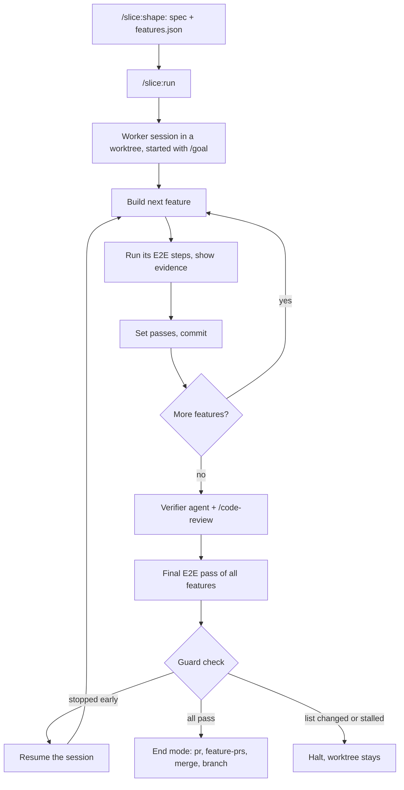

# slice

slice plans bigger work as a product spec plus an end-to-end feature list, then lets one long Claude Code session build it. A feature counts as done only after its E2E steps ran against the running app and the evidence is in the conversation. It builds on Claude Code's `/goal`, your project's verify recipe and `/code-review`.

## Requirements

| Software | Needed for | Check |
| --- | --- | --- |
| Claude Code (tested with 2.1.316) | the plugin, its mod and the builder sessions | `claude --version` |
| git | run worktree, diffs, state | `git --version` |
| gh | only the `pr` and `feature-prs` end modes | `gh auth status` |

Node.js is optional: `scripts/ui-check.mjs` uses it for screenshots of UI states.

## Setup

1. Install from the cflow marketplace: `/plugin install slice@cflow`.
2. Run `/slice:setup` in the repo. It writes the marker `.claude/slice.json` and checks that `.claude/skills/verify/SKILL.md` exists. If it doesn't, record one with `/run-skill-generator` or `/verify` and run setup again. Restart the session afterwards, because the mod reads the marker at session start.

## Use

- **Small ticket.** Just ask. Claude changes the code, runs the verify recipe, shows the evidence and commits only after that.
- **Bigger work.** `/slice:shape` interviews you (at most 6 questions) and writes `.slice/spec.md` and `.slice/features.json`, optionally one GitHub issue per feature. Review both files, then run `/slice:run [pr|feature-prs|merge|branch]`.
- **End modes.** `pr` pushes the run branch and opens one draft PR. `feature-prs` opens one stacked draft PR per feature commit. `merge` merges the run branch into the base branch locally. `branch` leaves the branch alone. Without an argument, `/slice:run` takes `end` from the marker, or asks once.
- `/background` detaches the session while the run goes on. `/slice-status` shows branch, passed/total, cost and the last action. `/slice-miss "<line>"` records something the checks missed and can propose a rule for your verification section.

## How a run works

A feature it can't finish stays `passes: false` with the reason in `.slice/progress.md`, and the worker moves on.

## What the guard catches

After every builder exit, `.slice/features.json` may differ from the run base only in `passes`. Any other change halts the run.

Each builder call is limited by `budgetUsd` (default 30) and `maxTurns` (default 400) from `.claude/slice.json`. A builder that stops early is resumed with its context (`claude -p --resume`). Two resumes in a row without a newly passing feature halt the run; so does a builder that reports success while features remain after one resume. The whole run is capped by `runBudgetUsd` (default 5 times `budgetUsd`): once the summed cost reaches it and the run is not finished, the run halts. On a halt the worktree stays for inspection.

## Where things live

| What | Where |
| --- | --- |
| Marker: `excludedCommands`, `allowedDomains`, `budgetUsd`, `maxTurns`, `runBudgetUsd`, `end` | `.claude/slice.json` |
| Spec, feature list, builder log | `.slice/spec.md`, `.slice/features.json`, `.slice/progress.md` |
| Run worktree and builder output | `~/.cache/slice/<repo>-<hash>/` (or under `XDG_CACHE_HOME`) |
| Run state and event log | `.git/slice/` |

Run model, effort and fallback model are plugin options (defaults `opus`, `high`, `sonnet`).

## Limits

- Cloud runs aren't tested end to end yet.
- The builder runs sandboxed with `failIfUnavailable`. Network is limited to the package registries plus `allowedDomains`, and commands in `excludedCommands` run unsandboxed.
- The plugin is small, around 1400 lines.
